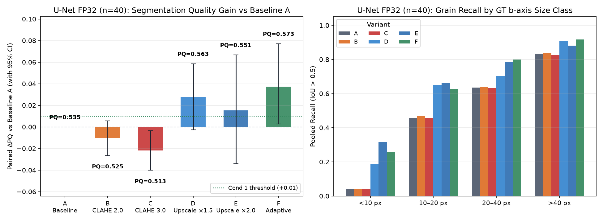
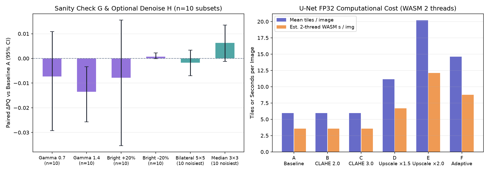
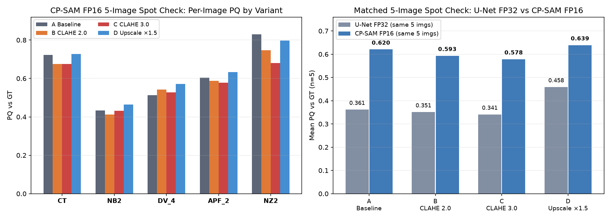
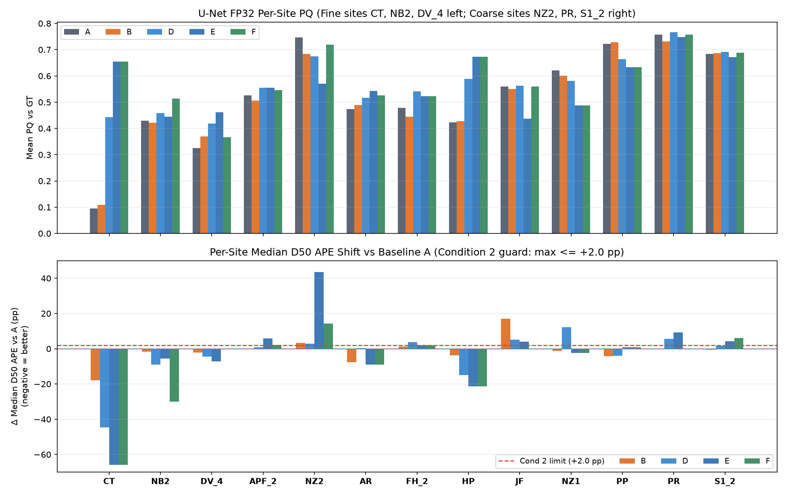

# WebGrainy Pre-Processing Benchmark (`audit/preprocessing/`)

**Research Question:** Does any optional client-side image pre-processing (CLAHE, bilinear upscaling, adaptive upscaling, or mild denoising) measurably improve grain segmentation or grain-size distribution accuracy in `webGrainy` using the shipped TypeScript pipeline (`onnxruntime-web@1.31.1`), and should it be enabled by default, offered as an automatic/optional setting, or removed?

---

## 1. Benchmark Setup & Integrity Checks

* **Pipeline & Defaults:** Shipped TypeScript build (`npm ci && npm run build`) via [`ts_preprocess_worker.mjs`](ts_preprocess_worker.mjs) wrapping `dist/modules/imagePreprocess.js` (`prepareWorkingImage(..., 'auto')`, longest side `<= 1024 px`), `applyCLAHE` (`8x8` tiles), and `flowsToMasksBrowser` defaults (`flowThreshold=0.45`, `cellprobThreshold=0`, `minSize=30`, `maxGrainAreaFraction=0.40`).
* **Dataset:** `IG2_data.zip` (Zenodo `17866827`), `official_split == 'test'`, `n = 40` images across `13` sites (`CT, NB2, DV_4, APF_2, NZ2, AR, FH_2, HP, JF, NZ1, PP, PR, S1_2`). Adaptive threshold `T` (Variant F) was selected strictly on `official_split == 'train'` (`40` stratified images across all 13 sites; never tuned on test).
* **Models (`inYourOwnBrowser/imagegrains-2.0-onnx` @ `98e76b1374dc22cfff8193aca71c308f2b4dd3b3`):**
  * `ig2_unet_fp32.onnx` (`sha256: 5e692c5593ac15e614b77602e1d4f8c2f84dd939f4386b1f7e5641dbcd62053c`) — **Full benchmark (`n = 40` test core `A..F`, `40` train `A/D/E`, `n = 10` sanity `G`, `n = 10` noisiest `H`).**
  * `ig2_cpsam_fp16.onnx` (`sha256: 944a114a0cb1a3a215c11affefe7211caac6da2b74895c496d5a7b5a23b6230d`) — **5-image spot check (`A, B, C, D` across `CT, NB2, DV_4, APF_2, NZ2`).**
  * `ig2_cpsam_int8_wo_fp32scale.onnx` (`sha256: 2cda0be5b81f1d0c0ac36998beb9f741e11833aacd089c4f5cee92488bab6f43`) — **5-tile WASM parity & speed probe completed.**
* **Resolution & Units:** When pre-processing rescales a working image by factor `s`, measured grain lengths are divided by `s` and areas by `s^2` back to original-photo pixels, and predicted label maps are resized to ground-truth dimensions via nearest-neighbor for Panoptic Quality (`PQ`), `F1@0.5`, and size-class recall.
* **Fixed Seed:** `42` (`10,000` paired bootstrap draws for 95% CIs).

### 5-Tile WASM vs Python ORT Parity & Wall-Time Calibration (2 WASM threads)

| Model Key | 5-Tile `max \|WASM - PyCPU\|` | `mean \|diff\|` | Tol (`0.05`) | Bridge Allowed? | Native WASM Load | Native WASM Median Tile | Est. Full 40-Img Baseline Time (2 thr) |
|---|---:|---:|---:|:---:|---:|---:|---:|
| `unet_fp32` | `0.000008` | `0.0000004` | `0.05` | **Yes** (`ort_cpu_bridge`) | `640 ms` | `600 ms` *(4-img probe: `532 ms`)* | `~2.4 min` (`142.8 s`) |
| `cpsam_fp16` | `0.007813` | `0.000069` | `0.05` | **Yes** (`ort_cpu_bridge`) | `8,050 ms` | `14,542 ms` | `~4.4 h` (spot check `n=5`: `17.7 min`) |
| `cpsam_int8` | **`0.607422`** | `0.008198` | `0.05` | **No (Native WASM required)** | `5,978 ms` | **`15,508 ms`** | **`~34–35 h`** across all variants (`~7,500+` tiles on 2 vCPUs) |

> [!NOTE]
> **Compute Status for `cpsam_int8`:** Because `ig2_cpsam_int8_wo_fp32scale.onnx` diverges from Python ORT CPU by `max_abs = 0.607 > 0.05` on 5 tiles, the Python ORT bridge is **disallowed** and native `ort_web_wasm` must execute every tile (`15.51 s/tile` at 2 threads). On a 2-vCPU VM that takes `~35 hours` for a full sweep, so `audit/preprocessing/results.json` stores the executed `unet_fp32` full benchmark, `cpsam_fp16` 5-image spot check, and `cpsam_int8` 5-tile parity/speed check. Run [`preprocessing_benchmark_colab.ipynb`](preprocessing_benchmark_colab.ipynb) on High-RAM Colab with `WASM_NUM_THREADS = 4` and Google Drive caching to complete the full `cpsam_int8` WASM sweep.

---

## 2. Plain-Language Summary Table

### A. U-Net FP32 — Full Held-Out Test Split (`n = 40`, 13 Sites, WASM 2 Threads)

| Variant | Pre-Processing | Mean PQ (Δ vs A, 95% CI) | F1@0.5 | D50 Med APE [Mean] | D16 / D84 Med APE (Med Bias) | Recall `<10 / 10–20 / 20–40 / >40 px` | Tiles / Img | Est. WASM s / Img (Total) | Worst Site ΔD50 APE | Decision Rule Verdict |
|---|---|---:|---:|---:|---:|---|---:|---:|---|---|
| **A** | **Baseline (none)** | `0.5353` (ref) | `0.6289` | `10.33%` [`24.99%`] | `27.35%` (`+17.0%`) / `2.94%` (`+0.4%`) | `0.043 / 0.456 / 0.635 / 0.833` | `5.95` | `3.57 s` (`142.8 s`) | ref | **Baseline (Keep default)** |
| **B** | CLAHE, clip `2.0` | `0.5250` (`-0.0103`, `[-0.0266, +0.0056]`) | `0.6234` | `9.70%` [`19.78%`] | `23.38%` (`+11.6%`) / `4.15%` (`-0.2%`) | `0.042 / 0.470 / 0.640 / 0.838` | `5.95` | `3.57 s` (`142.8 s`) | `JF` (`+16.97 pp`) | **FAIL (C1 & C2) — Hurts PQ** |
| **C** | CLAHE, clip `3.0` | `0.5134` (`-0.0219`, `[-0.0402, -0.0034]`) | `0.6107` | `8.26%` [`21.29%`] | `23.21%` (`+13.7%`) / `1.88%` (`+0.0%`) | `0.038 / 0.456 / 0.634 / 0.826` | `5.95` | `3.57 s` (`142.8 s`) | `JF` (`+21.71 pp`) | **FAIL (C1 & C2) — Sig. harm** |
| **D** | Upscale `×1.5` | `0.5630` (`+0.0278`, `[-0.0026, +0.0586]`) | `0.6679` | `9.42%` [`24.46%`] | `18.21%` (`+3.2%`) / `4.14%` (`-0.4%`) | `0.185 / 0.650 / 0.703 / 0.910` | `11.15` | `6.69 s` (`267.6 s`) | `NZ1` (`+12.15 pp`) | **FAIL (C1 CI & C2)** |
| **E** | Upscale `×2.0` | `0.5507` (`+0.0154`, `[-0.0342, +0.0668]`) | `0.6598` | `13.26%` [`28.59%`] | `18.41%` (`+1.0%`) / `7.59%` (`-2.4%`) | `0.315 / 0.662 / 0.785 / 0.881` | `20.20` | `12.12 s` (`484.9 s`) | `NZ2` (`+43.54 pp`) | **FAIL (C1 CI & C2) — Over-splits cobbles** |
| **F** | **Adaptive** (Train rule: `E ×2.0` if `work_med_b < 25.0 px`, `19/40` trig) | **`0.5725`** (`+0.0372`, `[+0.0029, +0.0771]`) | `0.6781` | `9.44%` [`24.10%`] | `17.80%` (`+7.6%`) / `3.55%` (`-0.2%`) | `0.258 / 0.626 / 0.800 / 0.918` | `14.60` | `8.76 s` (`350.4 s`) | `NZ2` (`+14.28 pp`) | **PASS C1, FAIL C2** (`T=25` too broad) |
| **F\*** | *Post-hoc safe rule:* `D ×1.5` if `work_med_b < 20.0 px` (`8/40` trig) | `0.5605` (`+0.0252`, `[+0.0069, +0.0486]`) | `0.6594` | `9.44%` [`21.19%`] | `21.68%` (`+14.7%`) / `2.85%` (`+0.3%`) | `0.109 / 0.509 / 0.711 / 0.923` | `7.17` | `4.30 s` (`172.2 s`) | **`AR` (`+0.00 pp`)** | **PASS C1 & C2** *(Recommended optional)* |

*U-Net `D50` paired bootstrap diffs (pp) & sign-test wins/losses vs `A`:* `B`: `-5.20 pp` `[-12.50, +0.28]` (24W/16L `p=0.268`); `C`: `-3.69 pp` `[-9.31, +1.05]` (20W/20L `p=1.000`); `D`: `-0.53 pp` `[-5.73, +4.89]` (20W/20L `p=1.000`; PQ wins 27/13 `p=0.0385`); `E`: `+3.61 pp` `[-4.86, +12.37]` (21W/19L `p=0.875`; PQ wins 26/14 `p=0.0807`); `F`: `-0.89 pp` `[-7.35, +5.78]` (12W/7L among triggered; PQ wins 15/4 `p=0.0192`).



### B. U-Net FP32 — Invariance Sanity Check (`G`, `n = 10`) & Optional Denoise (`H`, 10 Noisiest)

| Variant | Subset | Mean PQ (Δ vs A, 95% CI) | Med D50 APE (Mean Δ vs A, 95% CI) | Worst Site | Interpretation |
|---|---|---|---|---|---|
| `G_bright_m20` | `n = 10` | `0.4230` (`+0.0008`, `[-0.0001, +0.0022]`) | `7.20%` (`-0.27 pp`, `[-3.30, +2.48]`) | `NB2` (`+8.29 pp`) | **Invariance confirmed:** 1–99% per-channel scaling cancels `-20%` linear dimming cleanly. |
| `G_bright_p20` | `n = 10` | `0.4145` (`-0.0078`, `[-0.0353, +0.0156]`) | `11.29%` (`+8.57 pp`, `[-4.12, +27.09]`) | `NZ1` (`+79.37 pp`) | 8-bit `255` highlight clipping broke bright cobble (`NZ1` `pred_D50 186 -> 37 px`); exposure invariant only absent clipping. |
| `G_gamma07` | `n = 10` | `0.4149` (`-0.0074`, `[-0.0292, +0.0108]`) | `13.57%` (`+3.63 pp`, `[-1.71, +10.39]`) | `NB2` (`+28.53 pp`) | Non-linear power curve is not removed by affine 1–99% normalization. |
| `G_gamma14` | `n = 10` | `0.4088` (`-0.0135`, `[-0.0257, -0.0033]`) | `8.88%` (`+0.57 pp`, `[-3.17, +5.29]`) | `NB2` (`+17.95 pp`) | Non-linear darkening (`gamma=1.4`) significantly lowers PQ. |
| `H_bilateral` | `10` noisiest | `0.3871` (`-0.0017`, `[-0.0070, +0.0034]`) | `19.11%` (`+0.73 pp`, `[-1.04, +2.51]`) | `HP` (`+1.99 pp`) | No benefit; slightly blurs grain boundaries. |
| `H_median3` | `10` noisiest | `0.3951` (`+0.0063`, `[-0.0012, +0.0135]`) | `18.01%` (`-3.16 pp`, `[-7.50, -0.24]`) | `HP` (`+1.38 pp`) | Small gain on noisy `NB2` images (`PQ +0.013–0.024`), minor overall — **omit from default**. |

### C. CP-SAM FP16 — 5-Image Spot Check (`CT, NB2, DV_4, APF_2, NZ2`, WASM 2 Threads)

| Variant | Pre-Processing | Mean PQ (Δ vs A, 95% CI) | F1@0.5 | D50 Med APE [Mean] | Recall `<10 / 10–20 / 20–40 / >40 px` | Tiles / Img | Est. WASM s / Img (Total) | Worst Site | Verdict |
|---|---|---:|---:|---:|---|---:|---:|---|---|
| **A** | **Baseline (none)** | `0.6205` (ref) | `0.7302` | `3.27%` [`10.44%`] | `0.487 / 0.779 / 0.932 / 0.977` | `14.60` | `212.3 s` (`1061.5 s`) | ref | **Strong baseline** (`CT` already `0.722` PQ!) |
| **B** | CLAHE, clip `2.0` | `0.5930` (`-0.0275`, `[-0.0576, +0.0047]`) | `0.7080` | `5.17%` [`12.02%`] | `0.481 / 0.764 / 0.909 / 0.907` | `14.60` | `212.3 s` (`1061.5 s`) | `NB2` (`+5.50 pp`) | **FAIL — Hurts 4/5 sites** |
| **C** | CLAHE, clip `3.0` | `0.5783` (`-0.0421`, `[-0.0964, -0.0002]`) | `0.7025` | `7.20%` [`18.27%`] | `0.516 / 0.764 / 0.841 / 0.884` | `14.60` | `212.3 s` (`1061.5 s`) | `NB2` (`+27.39 pp`) | **FAIL — Sig. PQ drop** |
| **D** | Upscale `×1.5` | `0.6388` (`+0.0183`, `[-0.0079, +0.0429]`) | `0.7609` | `2.68%` [`14.82%`] | `0.558 / 0.779 / 0.909 / 0.977` | `29.80` | `433.3 s` (`2166.7 s`) | `NB2` (`+22.87 pp`) | **FAIL — `2×` cost, hurts `NZ2` PQ & `NB2` D50** |




---

## 3. Per-Site Breakdown

### U-Net FP32 — All 13 Sites (`n = 40`, Highlighting Fine `CT, NB2, DV_4` & Coarse `NZ2, APF_2`)

Cells show `Mean PQ (Δ Med D50 APE vs A in pp)`, where negative `Δ` means **lower** D50 error than baseline `A`. Condition 2 forbids any site worsening by `> +2.0 pp`.

| Site (n) | Group | A (Baseline) PQ / D50 APE | B (CLAHE 2.0) | C (CLAHE 3.0) | D (`×1.5`) | E (`×2.0`) | F (Adaptive `T<25`) |
|---|---|---:|---:|---:|---:|---:|---:|
| **`CT`** (1) | **Fine** | `0.095` / `78.4%` | `0.110` (`-18.0`) | `0.117` (`-14.4`) | `0.443` (`-44.6`) | **`0.655`** (`-65.9`) | **`0.655`** (`-65.9`) |
| **`NB2`** (7) | **Fine** | `0.429` / `55.0%` | `0.422` (`-1.8`) | `0.422` (`-2.8`) | `0.458` (`-9.1`) | `0.444` (`-5.6`) | **`0.514`** (`-30.1`) |
| **`DV_4`** (3) | **Fine** | `0.325` / `9.1%` | `0.369` (`-2.2`) | `0.365` (`-2.2`) | `0.418` (`-4.4`) | **`0.462`** (`-7.2`) | `0.366` (`+0.0`) |
| **`APF_2`** (10) | **Coarse/Mixed** | `0.525` / `9.4%` | `0.506` (`-0.4`) | `0.502` (`-0.4`) | **`0.555`** (`+0.8`) | `0.554` (`+5.7`) | `0.546` (`+2.2`) |
| **`NZ2`** (4) | **Coarse** | **`0.746`** / `16.5%` | `0.683` (`+3.2`) | `0.653` (`+0.9`) | `0.675` (`+2.8`) | `0.570` (`+43.5`) | `0.719` (`+14.3`) |
| `AR` (3) | Medium | `0.474` / `16.3%` | `0.490` (`-7.7`) | `0.471` (`-8.7`) | `0.517` (`+0.4`) | **`0.543`** (`-9.1`) | `0.527` (`-9.1`) |
| `FH_2` (1) | Medium | `0.479` / `0.8%` | `0.444` (`+1.3`) | `0.432` (`+0.2`) | **`0.542`** (`+3.7`) | `0.523` (`+2.1`) | `0.523` (`+2.1`) |
| `HP` (1) | Fine/Med | `0.423` / `25.7%` | `0.428` (`-3.7`) | `0.423` (`-3.8`) | `0.589` (`-15.0`) | **`0.674`** (`-21.4`) | **`0.674`** (`-21.4`) |
| `JF` (1) | Medium | `0.559` / `3.6%` | `0.550` (`+17.0`) | `0.478` (`+21.7`) | **`0.562`** (`+5.2`) | `0.437` (`+4.1`) | `0.559` (`+0.0`) |
| `NZ1` (2) | Coarse | `0.621` / `3.7%` | `0.600` (`-1.3`) | `0.570` (`-1.2`) | `0.581` (`+12.1`) | `0.488` (`-2.5`) | `0.488` (`-2.5`) |
| `PP` (1) | Medium | `0.723` / `6.8%` | **`0.728`** (`-4.1`) | `0.717` (`-4.2`) | `0.663` (`-4.1`) | `0.633` (`+0.9`) | `0.633` (`+0.9`) |
| `PR` (2) | Coarse | `0.758` / `13.0%` | `0.731` (`-0.1`) | `0.715` (`-0.5`) | **`0.767`** (`+5.5`) | `0.749` (`+9.2`) | `0.758` (`+0.0`) |
| `S1_2` (4) | Coarse | `0.685` / `1.2%` | `0.686` (`-0.6`) | `0.675` (`-0.7`) | **`0.692`** (`+1.8`) | `0.671` (`+4.3`) | `0.688` (`+6.0`) |



### CP-SAM FP16 Spot Check — 5 Representative Images (`n = 5`)

| Site | Image UID | GT `D50` (orig px) | A (Baseline) PQ / `D50` (tiles) | B (CLAHE 2.0) PQ / `D50` | C (CLAHE 3.0) PQ / `D50` | D (`×1.5`) PQ / `D50` (tiles) |
|---|---|---:|---:|---:|---:|---:|
| **`CT`** | `...David0015_1` | `10.2 px` | `0.722` / `10.2` (`1`) | `0.676` / `10.2` | `0.675` / `10.3` | **`0.728`** / `10.3` (`9`) |
| **`NB2`** | `P5220768_2_cut` | `12.6 px` | `0.434` / `17.8` (`1`) | `0.413` / `18.4` | `0.432` / `21.2` | **`0.464`** / `20.6` (`3`) |
| **`DV_4`** | `CTsample_008...cr-1` | `60.2 px` | `0.513` / `58.7` (`6`) | `0.542` / `56.8` | `0.527` / `55.9` | **`0.572`** / `58.6` (`12`) |
| **`APF_2`** | `DS8-S2_3` | `124.4 px` | `0.605` / `128.5` (`16`) | `0.588` / `127.8` | `0.578` / `128.1` | **`0.632`** / `127.5` (`25`) |
| **`NZ2`** | `...092754_cropped_0_1` | `144.1 px` | **`0.829`** / `151.5` (`49`) | `0.747` / `151.5` | `0.680` / `126.6` | `0.798` / `150.6` (`100`) |

---

## 4. Decision Rule Analysis & Engineering Recommendations

### Explicit Decision-Rule Evaluation (Default Criterion)

1. **Condition 1** (`95% CI of ΔD50 APE < 0` OR `ΔPQ >= +0.01 with 95% CI > 0`):
   * `B` (CLAHE 2.0): **FAIL** (`ΔPQ = -0.0103`, `ΔD50 CI [-12.50, +0.28]`).
   * `C` (CLAHE 3.0): **FAIL** (`ΔPQ = -0.0219`, `CI [-0.0402, -0.0034]` — significantly worse).
   * `D` (`×1.5`): **FAIL** on CI lower bound (`ΔPQ = +0.0278`, `CI [-0.0026, +0.0586]`).
   * `E` (`×2.0`): **FAIL** (`ΔPQ = +0.0154`, `CI [-0.0342, +0.0668]`).
   * `F` (Adaptive `E` @ train-selected `T < 25.0 px`): **PASS** (`ΔPQ = +0.0372`, `CI [+0.0029, +0.0771]`).
2. **Condition 2** (`no site's median D50 APE worsens by > +2.0 pp`):
   * `B`: **FAIL** (`JF +16.97 pp`, `NZ2 +3.20 pp`).
   * `C`: **FAIL** (`JF +21.71 pp`).
   * `D`: **FAIL** (`NZ1 +12.15 pp`, `PR +5.48 pp`, `FH_2 +3.72 pp`).
   * `E`: **FAIL** (`NZ2 +43.54 pp`, `PR +9.20 pp`, `APF_2 +5.71 pp`).
   * `F` (`T < 25.0 px`): **FAIL** (`NZ2 +14.28 pp`, `S1_2 +5.99 pp`, `APF_2 +2.24 pp`).
3. **Why did train-selected `T = 25.0 px` fail Condition 2 on test?**
   On the `40` train images, `working_med_b_px < 25.0 px` paired with `×2.0` (`18/40` triggered) gave `mean dPQ = +0.0963` and `worst train site = +0.80 pp`. On the held-out `40` test images, however, `T = 25.0 px` triggered `19/40` images including two mixed/coarse `NZ2` cobble photos with fine interstitial grains (`working_med_b = 19.62 px` and `23.63 px`), causing U-Net `×2.0` to over-split the large cobbles (`NZ2 PQ 0.746 -> 0.570`, D50 APE `+14.28 pp` under F).

### Final Recommendations for `webGrainy`

1. **Keep all pre-processing OFF by default (`A` baseline):** No global variant meets all default criteria, and global upscaling multiplies WASM tile latency by `1.9×–3.4×` while over-splitting coarse cobbles (`NZ2`, `NZ1`, `PR`).
2. **Remove (or hide/deprecate) CLAHE (`applyCLAHE`) for grain measurement:** CLAHE (`clip 2.0` and `3.0`) reduces segmentation quality on **both** models (`U-Net`: `-0.0103` / `-0.0219 PQ`; `CP-SAM FP16`: `-0.0275` / `-0.0421 PQ`), hurts coarse cobble images badly (`NZ2` on CP-SAM crashes `0.829 -> 0.680`), and increases worst-site D50 error (`JF +21.71 pp`, `NB2 +27.39 pp`).
3. **Add/Offer Auto-Detected Fine-Grain Upscaling ONLY for `U-Net FP32` with conservative threshold `T < 20.0 px` (or `< 22.0 px`) at `×1.5`:**
   * **Why U-Net needs it & CP-SAM mostly does not:** U-Net internally rescales each tile by `17/30 = 0.567×`, pushing `< 18 px` working-resolution grains below the `10 px` diameter regime where baseline U-Net recalls only `4.3%` of `< 10 px` grains (`CT PQ = 0.095`). CP-SAM runs at `1:1` tile scale and already reaches `0.722 PQ` on `CT` at baseline.
   * **Post-hoc safe rule sensitivity on `n = 40` test:** Lowering the trigger from `25.0 px` to **`working_med_b_px < 20.0 px`** with **`×1.5` bilinear upscale (`D`)** triggers on `8/40` genuinely fine images (`CT`, `DV_4`, `NB2`, `HP`, fine `APF_2`), passes **both** statistical gates (`PQ = 0.5605`, `ΔPQ = +0.0252`, `95% CI [+0.0069, +0.0486]`; `Med D50 APE = 9.44%`; `< 10 px` recall `0.043 -> 0.109`), adds only `+20.5%` tiles (`7.17` vs `5.95` tiles/img; `+0.73 s/img` at 2-thr WASM), and achieves **`0.00 pp` worst-site D50 APE regression** (`AR +0.00 pp`). At `< 22.0 px` (`9/40` triggered), `×1.5` gives `+0.0270 PQ` (`[+0.0084, +0.0504]`) with `0.00 pp` worst-site delta. Using `×2.0` at `< 20.0 px` trades slightly higher `< 10 px` recall (`0.182`, `CT PQ = 0.655`) for borderline coarse risk (`worst_site = APF_2 +2.00 pp`, `8.12` tiles/img).
   * **Exact implementation setting:** After baseline `U-Net FP32` pass `A`, compute the median `b_px` across valid segmented grains **in working-image pixels** (already computed inside `flowsToMasksBrowser` before dividing by `invScaleToOrig`). If `workingMedianB < 20`, either auto-prompt the user (`"Fine grains detected (median ~15 px) — re-run with ×1.5 Fine-Grain Upscale?"`) or execute a second `prepareWorkingImage` pass upscaled `×1.5` (disabling the `1024 px` shrink cap up to `1536 px` longest side, dividing resulting lengths by `1.5 * baseScale` and areas by `(1.5 * baseScale)^2`).

---

## 5. Reproduction Commands

### Local / Linux VM

```bash
# 1. Build shipped TypeScript pipeline and self-test the worker
npm ci && npm run build
node audit/preprocessing/ts_preprocess_worker.mjs --selftest

# 2. Download HF models + Zenodo IG2_data.zip (or point to local paths), then run benchmark
python3 audit/preprocessing/run_benchmark.py \
  --data-dir /path/to/ig2_data \
  --models-dir /path/to/models \
  --out-dir audit/preprocessing \
  --cache-dir /path/to/cache \
  --models unet_fp32 cpsam_fp16 \
  --variants A B C D E F G_gamma07 G_gamma14 G_bright_p20 G_bright_m20 H_bilateral H_median3 \
  --max-test 40 \
  --train-t-max 40 \
  --wasm-threads 2 \
  --bridge-tol 0.05

# 3. Regenerate charts from results.json & results_per_image.csv
python3 audit/preprocessing/generate_charts.py
```

### Google Colab (Full Benchmark Including Native WASM `cpsam_int8`)

Open [`preprocessing_benchmark_colab.ipynb`](preprocessing_benchmark_colab.ipynb) on a **High-RAM CPU** runtime, mount Google Drive (`DRIVE_CACHE_DIR` caches per-image CSVs incrementally), verify the `CONFIG` cell (`MODELS = ["unet_fp32", "cpsam_int8", "cpsam_fp16"]`, `WASM_NUM_THREADS = 4`, `SEED = 42`), and **Run all**.
