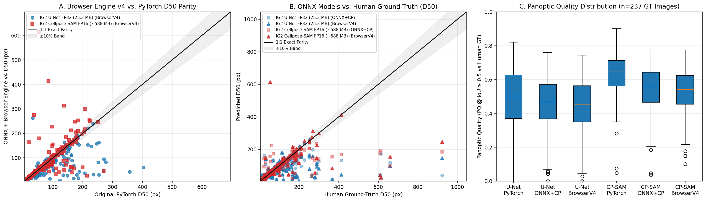

# ImageGrains 2.0 — Complete Ground-Truth Dataset Validation Report

> **Interpretation caveats (added after the pre-release audit, see `AUDIT_REPORT.md` F-02 and `audit/recompute_validation.py`):**
> - **Not a held-out estimate.** Every row has `split = test`, but 197 of the 237 grain-bearing images carry `site = train`. The browser-engine post-processing (flow-QC formulation, the `maxGrainAreaFraction = 0.15` guard added as the "`3ca10b7c` fix", which is not in this notebook run) was developed while looking at images in this set.
> - **Restricted to `site = test` (n = 40)**, the browser-engine D50 MAPE vs human GT is **31.3%** (median 15.7%) for U-Net and **12.5%** (median 4.7%) for Cellpose-SAM.
> - **Metric references.** "D50 MAPE vs GT" is relative to hand-digitised masks, in pixels. "vs PT" is relative to the PyTorch model's own output. Do not mix them.
> - **Error distributions are long-tailed:** 34 of 235 (U-Net) and 14 of 237 (CP-SAM) images exceed 50% D50 error, with a maximum of 1039% (CP-SAM, `3ca10b7c`).
> - **Parameters.** The browser engine in this run used `flow_thresh = 0.45`, `min_size = 30`, `cellprob = 0`, `niter = 250`, `margin = 2`. These are the v1.1.0 app defaults.

- **Last Updated:** 2026-11-14 06:18 UTC
- **Progress:** U-Net `238 / 238` | Cellpose-SAM `238 / 238`
- **Compute Hardware:** `NVIDIA L4` | Python 3.13.16 | PyTorch 2.14.1+cu130
- **Hugging Face ONNX Repository:** [`inYourOwnBrowser/imagegrains-2.0-onnx`](https://huggingface.co/inYourOwnBrowser/imagegrains-2.0-onnx)

---

## 1. Aggregate Benchmark Metrics (All Grain-Bearing Ground-Truth Images)

All morphometric and PSD metrics are computed on **border-excluded interior grains** (`margin = 2 px`) using **area-weighted cumulative distributions** ($w_i \propto A_i$).

| Evaluated Model / Pipeline | Done / Total | Mean PQ vs PT | Mean PQ vs Human GT | D50 MAPE vs PT (%) | D16 / D50 / D84 MAPE vs GT (%) | D50 RMSE vs GT (px) / R2 | Mean Time (s/img) |
| :--- | ---: | ---: | ---: | ---: | ---: | ---: | ---: |
| Original PyTorch — IG2 U-Net (25.3 MB) | 238 / 238 (237 GT) | 1.000 (Ref) | 0.487 ± 0.177 | 0.00% | 40.54% / 28.37% / 16.04% | 81.27 px / 0.404 | 1.64s |
| ONNX + Cellpose Dynamics — IG2 U-Net (25.3 MB) | 238 / 238 (237 GT) | 0.544 ± 0.181 | 0.448 ± 0.162 | 25.11% (Med: 10.93%) | 28.48% / 26.90% / 20.40% | 98.41 px / 0.126 | 1.78s |
| ONNX + Browser Engine v4 (F5+F3) — IG2 U-Net (25.3 MB) | 238 / 238 (237 GT) | 0.522 (vs CP: 0.900) | 0.434 ± 0.161 | 21.65% (Med: 10.33%) | 28.67% / 22.93% / 18.53% | 101.49 px / 0.071 | ONNX 0.77s + Post 13.46s |
| Original PyTorch — IG2 Cellpose-SAM (~588 MB) | 238 / 238 (237 GT) | 1.000 (Ref) | 0.632 ± 0.120 | 0.00% | 20.81% / 23.59% / 19.28% | 90.43 px / 0.259 | 2.21s |
| ONNX + Cellpose Dynamics — IG2 Cellpose-SAM (~588 MB) | 238 / 238 (237 GT) | 0.767 ± 0.115 | 0.542 ± 0.129 | 9.87% (Med: 2.09%) | 21.12% / 21.35% / 19.02% | 83.35 px / 0.370 | 1.98s |
| ONNX + Browser Engine v4 (F5+F3) — IG2 Cellpose-SAM (~588 MB) | 238 / 238 (237 GT) | 0.728 (vs CP: 0.908) | 0.531 ± 0.124 | 23.33% (Med: 2.21%) | 19.62% / 15.85% / 10.75% | 89.68 px / 0.271 | ONNX 0.91s + Post 16.06s |

## 2. Non-Grain Clutter / Negative Control Tiles (`GT Grains = 0`)

| Model Family | Negative / Clutter Tiles | PT False-Positive Grains (Mean) | ONNX+CP False-Positive Grains (Mean) | BrowserV4 False-Positive Grains (Mean) |
| :--- | ---: | ---: | ---: | ---: |
| IG2 U-Net (25.3 MB) | 1 | 1.0 | 2.0 | 1.0 |
| IG2 Cellpose-SAM (~588 MB) | 1 | 0.0 | 1.0 | 1.0 |

## 3. Breakdown by `split` Column (all rows are `test`; see the caveat at the top about the `site` column)

| Model Family | Dataset Split | Images | PyTorch D50 MAPE (%) | ONNX+CP D50 MAPE (%) | BrowserV4 D50 MAPE (%) | BrowserV4 D50 RMSE / R2 | BrowserV4 PQ vs GT |
| :--- | ---: | ---: | ---: | ---: | ---: | ---: | ---: |
| IG2 U-Net (25.3 MB) | TEST | 237 | 28.37% | 26.90% | 22.93% | 101.49 px / 0.071 | 0.434 |
| IG2 Cellpose-SAM (~588 MB) | TEST | 237 | 23.59% | 21.35% | 15.85% | 89.68 px / 0.271 | 0.531 |

## 4. Full Per-Image Results Table

Full per-image metrics are saved in `full_dataset_benchmark.csv` and individual JSON records in `state/unet/` and `state/cpsam/`.

| model | split | site | uid | shape | gt_grains | pt_grains | cp_grains | v4_grains | pq_v4_vs_cp | pq_pt_vs_gt | pq_v4_vs_gt | gt_D50 | pt_D50 | v4_D50 | v4_D50_err_gt | v4_D50_err_pt |
| :--- | ---: | ---: | ---: | ---: | ---: | ---: | ---: | ---: | ---: | ---: | ---: | ---: | ---: | ---: | ---: | ---: |
| IG2 U-Net FP32 (25.3 MB) | test | test | 01ac8ca6_kanakacreek_020_4 | 512x512 | 53 | 29 | 45 | 45 | 0.947 | 0.605 | 0.556 | 186.41 | 183.76 | 190.11 | 1.99 | 3.45 |
| IG2 U-Net FP32 (25.3 MB) | test | train | 01cfd71e_K1_2_C1_DJI_0385_clipped_5 | 512x512 | 10 | 7 | 6 | 5 | 0.7845 | 0.6606 | 0.2992 | 89.5 | 100.65 | 53.18 | 40.58 | 47.16 |
| IG2 U-Net FP32 (25.3 MB) | test | test | 01eb89d5_Stream_sediment_KRS_21_48_4_P1030803_cropped__add1 | 1024x1024 | 166 | 110 | 140 | 133 | 0.9168 | 0.6847 | 0.6475 | 289.35 | 270.4 | 94.42 | 67.37 | 65.08 |
| IG2 U-Net FP32 (25.3 MB) | test | train | 02caa717_DJI_0126_1_4 | 512x512 | 32 | 15 | 20 | 19 | 0.8799 | 0.5455 | 0.5635 | 56.7 | 55.15 | 55.26 | 2.54 | 0.2 |
| IG2 U-Net FP32 (25.3 MB) | test | train | 03557b1a_Stream_sediment_HUR_22_1_20221209_092758_cropped_1_2 | 2750x2000 | 205 | 178 | 251 | 101 | 0.5798 | 0.7159 | 0.4081 | 178.22 | 151.28 | 126.65 | 28.94 | 16.28 |
| IG2 U-Net FP32 (25.3 MB) | test | test | 055bd145_CREF_2_T1 | 2480x2482 | 852 | 1248 | 1781 | 1002 | 0.6985 | 0.6325 | 0.6597 | 107.28 | 100.42 | 95.22 | 11.25 | 5.18 |
| IG2 U-Net FP32 (25.3 MB) | test | train | 070db96a_DSC_0596_1 | 1024x1024 | 9 | 13 | 17 | 14 | 0.7349 | 0.3668 | 0.1352 | 299.58 | 276.91 | 82.38 | 72.5 | 70.25 |
| IG2 U-Net FP32 (25.3 MB) | test | test | 07ef674a_Stream_sediment_HUR_22_1_20221209_092754_cropped_0_1 | 1024x1024 | 35 | 29 | 33 | 32 | 0.9523 | 0.7938 | 0.1402 | 144.06 | 145.36 | 119.79 | 16.85 | 17.59 |
| IG2 U-Net FP32 (25.3 MB) | test | test | 09774bc2_P5252021_1 | 256x256 | 120 | 22 | 32 | 31 | 0.9114 | 0.2797 | 0.3066 | 22.13 | 43.09 | 43.41 | 96.19 | 0.75 |
| IG2 U-Net FP32 (25.3 MB) | test | train | 0a45f860_S9_6_C1_DJI_0730_3 | 512x512 | 22 | 11 | 15 | 15 | 0.8226 | 0.6665 | 0.4436 | 83.28 | 91.91 | 92.31 | 10.83 | 0.43 |
| IG2 U-Net FP32 (25.3 MB) | test | train | 0ada85b0_Outcrop_KRS_22_18_23_31_IMG_6612_cropped_4 | 350x500 | 6 | 5 | 12 | 13 | 0.941 | 0.4821 | 0.3004 | 42.77 | 40.53 | 35.96 | 15.92 | 11.27 |
| IG2 U-Net FP32 (25.3 MB) | test | train | 0af4a9ff_DS8-S2_2 | 512x512 | 101 | 44 | 73 | 73 | 0.9545 | 0.5024 | 0.5809 | 92.85 | 101.41 | 101.14 | 8.93 | 0.26 |
| IG2 U-Net FP32 (25.3 MB) | test | test | 0b53cd2f_Outcrop_KRS_22_47_18_40_IMG_6628_cropped_1 | 1024x1024 | 493 | 324 | 480 | 472 | 0.9588 | 0.6603 | 0.6752 | 47.23 | 50.56 | 48.64 | 2.99 | 3.78 |
| IG2 U-Net FP32 (25.3 MB) | test | train | 0b5792b3_CTsample_028_5068_5_A_066_1_bc_8bit_cr-1 | 414x396 | 33 | 18 | 23 | 24 | 0.9778 | 0.4665 | 0.5688 | 32.68 | 36.24 | 34.05 | 4.2 | 6.02 |
| IG2 U-Net FP32 (25.3 MB) | test | test | 10a3628b_S1_g_DJI_0171_2_3 | 512x512 | 30 | 21 | 27 | 26 | 0.9397 | 0.6713 | 0.5827 | 148.76 | 146.11 | 80.17 | 46.11 | 45.13 |
| IG2 U-Net FP32 (25.3 MB) | test | train | 10e0771c_Stream_sediment_HUR_22_1_20221209_092758_cropped_1_4 | 1124x712 | 21 | 25 | 101 | 97 | 0.9748 | 0.646 | 0.0929 | 59.65 | 60.38 | 55.59 | 6.81 | 7.94 |
| IG2 U-Net FP32 (25.3 MB) | test | train | 11a96fce_S9_6_C1_DJI_0677_0 | 512x512 | 50 | 34 | 40 | 39 | 0.9588 | 0.6121 | 0.5855 | 128.87 | 117.98 | 130.34 | 1.14 | 10.48 |
| IG2 U-Net FP32 (25.3 MB) | test | train | 141e76d9_Rhein_1679_3 | 512x512 | 30 | 8 | 12 | 12 | 0.8205 | 0.3646 | 0.2766 | 92.86 | 118.19 | 116.32 | 25.26 | 1.59 |
| IG2 U-Net FP32 (25.3 MB) | test | train | 153b7f77_Simme_1633_1 | 512x512 | 55 | 34 | 57 | 57 | 0.9647 | 0.6483 | 0.6693 | 68.27 | 98.26 | 67.05 | 1.79 | 31.76 |
| IG2 U-Net FP32 (25.3 MB) | test | train | 154b160f_P5220899_Crop_2 | 383x602 | 40 | 21 | 27 | 25 | 0.9539 | 0.6617 | 0.546 | 203.14 | 216.91 | 220.33 | 8.46 | 1.58 |
| IG2 U-Net FP32 (25.3 MB) | test | test | 160b55ac_P5220899_1 | 256x300 | 55 | 29 | 38 | 38 | 0.92 | 0.4028 | 0.4327 | 27.47 | 32.16 | 24.54 | 10.67 | 23.69 |
| IG2 U-Net FP32 (25.3 MB) | test | test | 167ddf4c_GU_bar7_0 | 512x512 | 92 | 25 | 36 | 33 | 0.9257 | 0.4088 | 0.3903 | 39.73 | 43.47 | 45.9 | 15.54 | 5.6 |
| IG2 U-Net FP32 (25.3 MB) | test | train | 17e07e2f_Stream_sediment_RAKR_21_1_4_P1030821_cropped_4 | 720x450 | 13 | 12 | 16 | 15 | 0.9297 | 0.7811 | 0.414 | 35.49 | 206.38 | 36.99 | 4.21 | 82.08 |
| IG2 U-Net FP32 (25.3 MB) | test | train | 18960d78_kanakacreek_020_0 | 512x512 | 69 | 34 | 44 | 44 | 0.822 | 0.5535 | 0.4654 | 166.37 | 169.22 | 67.53 | 59.41 | 60.09 |
| IG2 U-Net FP32 (25.3 MB) | test | train | 18b4b016_3_P1060343_3 | 512x512 | 157 | 80 | 134 | 131 | 0.9648 | 0.5419 | 0.5818 | 39.23 | 44.23 | 39.47 | 0.61 | 10.77 |
| IG2 U-Net FP32 (25.3 MB) | test | train | 196c98a3_Thur_1781_2 | 512x512 | 900 | 196 | 540 | 551 | 0.9456 | 0.3016 | 0.5485 | 19.69 | 27.16 | 21.54 | 9.36 | 20.72 |
| IG2 U-Net FP32 (25.3 MB) | test | train | 1971e6cf_Outcrop_KRS_22_63_32_50_IMG_6662_cropped_4 | 312x500 | 21 | 14 | 27 | 26 | 0.881 | 0.5902 | 0.3598 | 179.73 | 54.72 | 52.4 | 70.84 | 4.23 |
| IG2 U-Net FP32 (25.3 MB) | test | train | 19dfee9c_Outcrop_KRS_22_47_18_40_IMG_6627_cropped_1 | 512x512 | 73 | 40 | 52 | 51 | 0.9403 | 0.6106 | 0.5547 | 26.84 | 30.97 | 29.73 | 10.79 | 4.0 |
| IG2 U-Net FP32 (25.3 MB) | test | train | 1c0517d2_DSC_0395_1 | 1024x1024 | 39 | 28 | 1 | 1 | 0.996 | 0.5413 | 0.0 | 366.56 | 169.37 | 16.49 | 95.5 | 90.26 |
| IG2 U-Net FP32 (25.3 MB) | test | train | 1e769a14_S1_g_DJI_0208_2_2 | 512x512 | 63 | 37 | 44 | 43 | 0.9612 | 0.6485 | 0.5793 | 52.84 | 63.89 | 63.55 | 20.27 | 0.53 |
| IG2 U-Net FP32 (25.3 MB) | test | train | 1ec76460_S1_b_DJI_0103_2_2 | 512x512 | 186 | 87 | 140 | 143 | 0.9387 | 0.5018 | 0.5846 | 44.63 | 49.11 | 46.05 | 3.18 | 6.23 |
| IG2 U-Net FP32 (25.3 MB) | test | train | 1f560b0f_DJI_0536_1_2 | 512x512 | 198 | 82 | 119 | 115 | 0.9357 | 0.4556 | 0.5013 | 39.79 | 46.36 | 36.29 | 8.79 | 21.71 |
| IG2 U-Net FP32 (25.3 MB) | test | train | 214301e8_S9_5_C1_DJI_0102_0 | 512x512 | 47 | 25 | 28 | 28 | 0.9857 | 0.5191 | 0.4237 | 79.25 | 80.47 | 79.73 | 0.6 | 0.92 |
| IG2 U-Net FP32 (25.3 MB) | test | train | 2165ba4d_P5251999_1 | 600x650 | 13 | 13 | 12 | 11 | 0.7809 | 0.4805 | 0.3663 | 252.04 | 252.36 | 81.86 | 67.52 | 67.56 |
| IG2 U-Net FP32 (25.3 MB) | test | test | 2284a529_L2_1_C1_DJI_0371_3 | 512x512 | 86 | 35 | 48 | 46 | 0.9321 | 0.4921 | 0.4879 | 118.94 | 134.36 | 137.54 | 15.64 | 2.37 |
| IG2 U-Net FP32 (25.3 MB) | test | train | 26df6359_CTsample_001_5068_1_C_002_1_bc_8bit_cr-1 | 294x419 | 30 | 7 | 17 | 17 | 0.9999 | 0.2227 | 0.4253 | 65.03 | 73.79 | 69.04 | 6.17 | 6.44 |
| IG2 U-Net FP32 (25.3 MB) | test | train | 26e25cc2_S9_6_C1_DJI_0730_2 | 512x512 | 278 | 104 | 205 | 205 | 0.9593 | 0.4674 | 0.6227 | 36.56 | 43.81 | 37.59 | 2.83 | 14.21 |
| IG2 U-Net FP32 (25.3 MB) | test | train | 27a6d07f_L2_1_C1_DJI_0352_3 | 512x512 | 234 | 83 | 136 | 132 | 0.9397 | 0.4241 | 0.4935 | 55.54 | 58.22 | 57.27 | 3.11 | 1.64 |
| IG2 U-Net FP32 (25.3 MB) | test | train | 28996d61_P5251813_1_4 | 575x325 | 0 | 1 | 2 | 1 | 0.6667 | 0.4538 | 0.0 | N/A | 76.58 | 76.67 | N/A | 0.12 |
| IG2 U-Net FP32 (25.3 MB) | test | train | 28ddd158_Stream_sediment_RAKR_21_1_4_P1030821_cropped__add1 | 1024x1024 | 166 | 134 | 125 | 122 | 0.9337 | 0.7859 | 0.69 | 124.01 | 124.71 | 75.28 | 39.3 | 39.64 |
| IG2 U-Net FP32 (25.3 MB) | test | train | 2c2b9354_DJI_0536_1_1 | 512x512 | 78 | 18 | 26 | 26 | 0.8708 | 0.3273 | 0.2782 | 227.33 | 234.18 | 238.67 | 4.99 | 1.92 |
| IG2 U-Net FP32 (25.3 MB) | test | test | 2c496065_PYRA_4_T0 | 1000x1000 | 324 | 328 | 463 | 454 | 0.9452 | 0.7258 | 0.6098 | 85.78 | 80.54 | 82.19 | 4.19 | 2.05 |
| IG2 U-Net FP32 (25.3 MB) | test | train | 2d1b0a0d_K1_2_C1_DJI_0385_1 | 512x512 | 227 | 112 | 189 | 196 | 0.9399 | 0.4826 | 0.6201 | 39.76 | 40.37 | 38.49 | 3.2 | 4.66 |
| IG2 U-Net FP32 (25.3 MB) | test | train | 3019ce48_DJI_0124_2__1 | 128x128 | 44 | 3 | 20 | 20 | 0.9742 | 0.1053 | 0.4108 | 13.44 | 18.12 | 15.81 | 17.67 | 12.73 |
| IG2 U-Net FP32 (25.3 MB) | test | train | 30c0765a_kanakacreek_020_2 | 512x512 | 45 | 29 | 30 | 31 | 0.9385 | 0.5653 | 0.5885 | 91.42 | 70.86 | 70.35 | 23.06 | 0.72 |
| IG2 U-Net FP32 (25.3 MB) | test | train | 3298f0a2_P5251740_Crop2 | 661x536 | 63 | 11 | 17 | 15 | 0.914 | 0.3149 | 0.2596 | 22.96 | 48.2 | 45.24 | 97.03 | 6.14 |
| IG2 U-Net FP32 (25.3 MB) | test | train | 332dc03f_S9_5_C1_DJI_0043_1 | 512x512 | 420 | 109 | 178 | 177 | 0.9759 | 0.3157 | 0.3849 | 37.77 | 44.02 | 40.41 | 6.99 | 8.19 |
| IG2 U-Net FP32 (25.3 MB) | test | test | 33d5e67e_P5262238_1 | 956x996 | 12 | 1 | 7 | 2 | 0.4 | 0.4555 | 0.0 | 198.23 | 122.69 | 7.73 | 96.1 | 93.7 |
| IG2 U-Net FP32 (25.3 MB) | test | train | 346aa390_Stream_sediment_HUR_22_1_20221209_092807_cropped_3_4 | 650x550 | 2 | 0 | 0 | 0 | 1.0 | 0.4173 | 0.0 | 62.34 | N/A | N/A | N/A | N/A |
| IG2 U-Net FP32 (25.3 MB) | test | test | 355e6ca2_Simme_1633_2 | 512x512 | 14 | 7 | 9 | 10 | 0.8426 | 0.5479 | 0.436 | 79.26 | 83.2 | 82.16 | 3.66 | 1.25 |
| IG2 U-Net FP32 (25.3 MB) | test | train | 359262af_7_P1060359_3 | 512x512 | 114 | 55 | 77 | 79 | 0.9654 | 0.5075 | 0.5609 | 38.3 | 43.72 | 42.08 | 9.86 | 3.76 |
| IG2 U-Net FP32 (25.3 MB) | test | train | 377e2d40_hiddencreek_003_4 | 512x512 | 130 | 54 | 83 | 83 | 0.9528 | 0.4143 | 0.4949 | 53.02 | 67.6 | 52.2 | 1.55 | 22.78 |
| IG2 U-Net FP32 (25.3 MB) | test | train | 38fc2975_6_P1060355_0 | 512x512 | 104 | 45 | 69 | 67 | 0.9444 | 0.4865 | 0.501 | 108.58 | 108.37 | 90.14 | 16.98 | 16.82 |
| IG2 U-Net FP32 (25.3 MB) | test | train | 39c17436_P5262238_2 | 956x1037 | 5 | 6 | 7 | 6 | 0.7958 | 0.4771 | 0.0 | 192.02 | 134.56 | 29.29 | 84.75 | 78.23 |
| IG2 U-Net FP32 (25.3 MB) | test | train | 3a56b432_IMG_0239_2 | 1024x1024 | 32 | 25 | 25 | 22 | 0.8905 | 0.7557 | 0.5966 | 79.65 | 79.13 | 96.46 | 21.11 | 21.89 |
| IG2 U-Net FP32 (25.3 MB) | test | train | 3aa2436e_Stream_sediment_HUR_22_1_20221209_092820_cropped_1_4 | 1024x1100 | 13 | 13 | 126 | 120 | 0.9651 | 0.5607 | 0.051 | 160.77 | 163.73 | 89.5 | 44.33 | 45.33 |
| IG2 U-Net FP32 (25.3 MB) | test | test | 3aed7b77_S1_g_DJI_0171_2_0 | 512x512 | 100 | 67 | 81 | 82 | 0.9451 | 0.6343 | 0.5969 | 67.82 | 68.85 | 66.74 | 1.6 | 3.07 |
| IG2 U-Net FP32 (25.3 MB) | test | train | 3b565425_DS8-S2_4 | 512x512 | 38 | 22 | 29 | 28 | 0.9217 | 0.6481 | 0.5232 | 80.65 | 82.74 | 82.25 | 1.99 | 0.59 |
| IG2 U-Net FP32 (25.3 MB) | test | train | 3b6a8164_Rhein_1679_2 | 512x512 | 47 | 34 | 54 | 55 | 0.941 | 0.73 | 0.6877 | 137.41 | 137.5 | 136.1 | 0.96 | 1.02 |
| IG2 U-Net FP32 (25.3 MB) | test | train | 3ca10b7c_Stream_sediment_KRS_21_48_4_P1030803_cropped_5 | 950x750 | 21 | 15 | 13 | 12 | 0.7563 | 0.4024 | 0.243 | 53.94 | 404.03 | 60.76 | 12.64 | 84.96 |
| IG2 U-Net FP32 (25.3 MB) | test | train | 3dc4eae4_PYRA_4_T1 | 1000x1000 | 202 | 257 | 342 | 331 | 0.9464 | 0.658 | 0.4642 | 75.24 | 83.83 | 73.56 | 2.23 | 12.25 |
| IG2 U-Net FP32 (25.3 MB) | test | train | 432ee192_1_P1060330_1 | 512x512 | 101 | 34 | 49 | 46 | 0.9505 | 0.3722 | 0.3772 | 49.8 | 62.17 | 53.34 | 7.12 | 14.2 |
| IG2 U-Net FP32 (25.3 MB) | test | train | 43da9e92_K1_2_C1_DJI_0385_clipped_3 | 512x512 | 25 | 17 | 20 | 17 | 0.8917 | 0.573 | 0.3083 | 65.03 | 71.92 | 67.26 | 3.43 | 6.47 |
| IG2 U-Net FP32 (25.3 MB) | test | train | 45d6e12d_DJI_0063_2__1 | 256x256 | 21 | 7 | 11 | 12 | 0.9559 | 0.2757 | 0.4575 | 24.81 | 36.01 | 33.38 | 34.53 | 7.3 |
| IG2 U-Net FP32 (25.3 MB) | test | train | 47f93052_5_P1060351_2 | 512x512 | 141 | 60 | 87 | 84 | 0.9533 | 0.4868 | 0.5075 | 44.59 | 44.18 | 49.4 | 10.8 | 11.83 |
| IG2 U-Net FP32 (25.3 MB) | test | train | 4907aa09_S1_a_DJI_0003_2_5 | 512x512 | 23 | 17 | 18 | 18 | 0.9243 | 0.5867 | 0.4343 | 56.7 | 62.47 | 62.33 | 9.93 | 0.21 |
| IG2 U-Net FP32 (25.3 MB) | test | test | 4af19cc6_P5240982_1 | 350x300 | 10 | 6 | 8 | 8 | 0.9461 | 0.6779 | 0.4687 | 100.59 | 96.39 | 97.21 | 3.36 | 0.86 |
| IG2 U-Net FP32 (25.3 MB) | test | test | 4d3abc7d_IMG_0239_0 | 1024x1024 | 88 | 67 | 85 | 84 | 0.9576 | 0.761 | 0.7445 | 183.42 | 152.5 | 135.3 | 26.23 | 11.28 |
| IG2 U-Net FP32 (25.3 MB) | test | train | 4ea69733_K1_2_C1_DJI_0385_clipped_0 | 512x512 | 18 | 12 | 16 | 15 | 0.9287 | 0.6919 | 0.5033 | 69.65 | 73.96 | 68.99 | 0.95 | 6.73 |
| IG2 U-Net FP32 (25.3 MB) | test | train | 50de4ea1_Stream_sediment_HUR_22_1_20221209_092754_cropped_2__add1 | 1024x1024 | 59 | 47 | 43 | 39 | 0.8482 | 0.7683 | 0.5858 | 128.09 | 137.02 | 132.54 | 3.48 | 3.27 |
| IG2 U-Net FP32 (25.3 MB) | test | train | 51bb2e2f_P5220667_4 | 300x350 | 75 | 12 | 21 | 18 | 0.8815 | 0.1525 | 0.1622 | 41.32 | 75.33 | 36.04 | 12.78 | 52.16 |
| IG2 U-Net FP32 (25.3 MB) | test | train | 52ac67e7_CTsample_016_5068_1_C_175_1_bc_8bit_cr-1189 | 304x420 | 15 | 8 | 10 | 8 | 0.8859 | 0.2976 | 0.3881 | 108.15 | 107.5 | 81.49 | 24.65 | 24.19 |
| IG2 U-Net FP32 (25.3 MB) | test | train | 52ba6cf8_CTsample_002_5068_1_C_029_1_bc_8bit_cr-2852 | 343x380 | 15 | 6 | 11 | 11 | 0.999 | 0.2093 | 0.3211 | 176.81 | 148.53 | 27.79 | 84.28 | 81.29 |
| IG2 U-Net FP32 (25.3 MB) | test | train | 547d7f87_S1_g_DJI_0208_2_4 | 512x512 | 118 | 72 | 94 | 92 | 0.9298 | 0.6222 | 0.581 | 65.06 | 74.94 | 72.28 | 11.09 | 3.55 |
| IG2 U-Net FP32 (25.3 MB) | test | train | 570febe9_S1_g_DJI_0171_2_1 | 512x512 | 48 | 32 | 38 | 37 | 0.9627 | 0.5935 | 0.5132 | 56.31 | 55.95 | 54.92 | 2.47 | 1.83 |
| IG2 U-Net FP32 (25.3 MB) | test | train | 58ad662e_P5262096_CROP_1 | 612x684 | 52 | 37 | 44 | 43 | 0.9582 | 0.6572 | 0.6048 | 94.72 | 94.94 | 99.16 | 4.69 | 4.45 |
| IG2 U-Net FP32 (25.3 MB) | test | train | 5964a9a7_SlicesY_contrast_8bit_440-1140_crop_flipZ_300-360_David0056_1 | 224x224 | 103 | 4 | 53 | 54 | 0.9747 | 0.0558 | 0.5019 | 9.15 | 13.71 | 10.73 | 17.31 | 21.72 |
| IG2 U-Net FP32 (25.3 MB) | test | train | 59d70934_CHPK_1_T0 | 1000x1000 | 613 | 431 | 989 | 973 | 0.9439 | 0.6511 | 0.5862 | 64.29 | 63.62 | 37.13 | 42.24 | 41.63 |
| IG2 U-Net FP32 (25.3 MB) | test | train | 5a11a493_CTsample_001_5068_1_C_002_1_bc_8bit_cr-1181 | 317x420 | 16 | 4 | 6 | 6 | 0.9998 | 0.1584 | 0.2352 | 146.63 | 150.4 | 142.79 | 2.62 | 5.06 |
| IG2 U-Net FP32 (25.3 MB) | test | train | 5a25dde9_Outcrop_KRS_22_47_18_40_IMG_6627_cropped_4 | 600x512 | 58 | 28 | 26 | 22 | 0.8912 | 0.5441 | 0.3579 | 35.17 | 36.7 | 27.34 | 22.26 | 25.51 |
| IG2 U-Net FP32 (25.3 MB) | test | train | 5aa6a118_Stream_sediment_HUR_22_1_20221209_092807_cropped_3__add1 | 1536x1536 | 25 | 28 | 22 | 10 | 0.4872 | 0.4052 | 0.2681 | 269.04 | 247.1 | 158.21 | 41.2 | 35.98 |
| IG2 U-Net FP32 (25.3 MB) | test | test | 5b0b88dc_CTsample_016_5068_1_C_175_1_bc_8bit_cr-1 | 304x420 | 15 | 8 | 10 | 9 | 0.9471 | 0.2834 | 0.3648 | 40.35 | 50.12 | 39.76 | 1.44 | 20.65 |
| IG2 U-Net FP32 (25.3 MB) | test | train | 5b2961f6_S9_5_C1_DJI_0102_1 | 512x512 | 67 | 43 | 52 | 50 | 0.9289 | 0.6275 | 0.6016 | 76.05 | 79.04 | 75.49 | 0.74 | 4.49 |
| IG2 U-Net FP32 (25.3 MB) | test | train | 5d3454a7_Stream_sediment_WKR_21_1_2_P1030816_cropped__add1 | 512x512 | 72 | 56 | 66 | 65 | 0.9319 | 0.8145 | 0.7278 | 43.02 | 44.48 | 44.72 | 3.94 | 0.53 |
| IG2 U-Net FP32 (25.3 MB) | test | train | 5e68c58a_IMG_0237_0 | 1024x1024 | 109 | 109 | 105 | 103 | 0.9741 | 0.7734 | 0.6728 | 127.27 | 128.98 | 122.87 | 3.46 | 4.74 |
| IG2 U-Net FP32 (25.3 MB) | test | train | 5ee493ed_P5262238_4 | 957x1037 | 4 | 4 | 4 | 4 | 0.2216 | 0.6491 | 0.0972 | 132.9 | 130.08 | 115.39 | 13.18 | 11.29 |
| IG2 U-Net FP32 (25.3 MB) | test | train | 5f1f9200_Outcrop_KRS_21_91_3_P1030700_cropped_1 | 500x500 | 182 | 38 | 62 | 62 | 0.9582 | 0.2697 | 0.3334 | 29.46 | 49.11 | 46.35 | 57.33 | 5.61 |
| IG2 U-Net FP32 (25.3 MB) | test | test | 60232c05_DSC_0577_1 | 512x511 | 28 | 12 | 20 | 17 | 0.8995 | 0.5808 | 0.4852 | 113.77 | 183.59 | 180.41 | 58.58 | 1.74 |
| IG2 U-Net FP32 (25.3 MB) | test | train | 6045b22a_DJI_0126_1_3 | 512x512 | 11 | 4 | 7 | 7 | 0.998 | 0.4394 | 0.4679 | 57.68 | 63.62 | 60.64 | 5.13 | 4.68 |
| IG2 U-Net FP32 (25.3 MB) | test | test | 60ef59fb_SlicesY_contrast_8bit_440-1140_crop_flipZ_300-360_David0015_1 | 224x224 | 127 | 7 | 77 | 75 | 0.9823 | 0.0888 | 0.5527 | 10.25 | 18.28 | 12.11 | 18.13 | 33.76 |
| IG2 U-Net FP32 (25.3 MB) | test | train | 6224f0e3_P5220899_Crop_4 | 455x397 | 124 | 30 | 73 | 75 | 0.9352 | 0.4051 | 0.5688 | 100.88 | 119.77 | 131.55 | 30.4 | 9.83 |
| IG2 U-Net FP32 (25.3 MB) | test | train | 6297d85f_Stream_sediment_HUR_22_1_20221209_092820_cropped_0_4 | 2450x1950 | 18 | 25 | 42 | 12 | 0.4044 | 0.4142 | 0.2386 | 922.77 | 228.05 | 146.52 | 84.12 | 35.75 |
| IG2 U-Net FP32 (25.3 MB) | test | test | 62d1036b_DS8-S2_3 | 512x512 | 81 | 34 | 53 | 57 | 0.9039 | 0.4747 | 0.4723 | 124.45 | 141.58 | 137.81 | 10.74 | 2.66 |
| IG2 U-Net FP32 (25.3 MB) | test | train | 62f16f4d_CAMP_1_T0 | 1000x1000 | 129 | 129 | 129 | 126 | 0.9574 | 0.8111 | 0.6805 | 99.46 | 99.6 | 87.91 | 11.61 | 11.74 |
| IG2 U-Net FP32 (25.3 MB) | test | train | 62fd842e_Stream_sediment_KRS_21_48_4_P1030803_cropped_4 | 875x675 | 21 | 12 | 19 | 15 | 0.789 | 0.5999 | 0.4627 | 413.64 | 39.77 | 44.83 | 89.16 | 12.73 |
| IG2 U-Net FP32 (25.3 MB) | test | train | 6443979c_P5220693_1 | 300x500 | 23 | 8 | 9 | 8 | 0.9085 | 0.4895 | 0.3068 | 120.07 | 126.46 | 129.2 | 7.6 | 2.17 |
| IG2 U-Net FP32 (25.3 MB) | test | train | 64a92836_Outcrop_KRS_21_27_1_P1030761_cropped_5 | 200x306 | 10 | 3 | 6 | 6 | 0.8718 | 0.2332 | 0.3903 | 15.16 | 24.41 | 20.41 | 34.63 | 16.38 |
| IG2 U-Net FP32 (25.3 MB) | test | train | 66ee6903_Luetschine_1652_2 | 512x512 | 58 | 16 | 18 | 17 | 0.9197 | 0.3068 | 0.3101 | 97.19 | 107.21 | 91.31 | 6.06 | 14.83 |
| IG2 U-Net FP32 (25.3 MB) | test | train | 6968ddc8_PYRA_2_T0 | 1000x1000 | 88 | 88 | 92 | 85 | 0.9315 | 0.7204 | 0.4786 | 136.01 | 136.02 | 69.98 | 48.55 | 48.55 |
| IG2 U-Net FP32 (25.3 MB) | test | train | 6b60e9b3_deer_creek_004_1 | 512x512 | 72 | 19 | 50 | 48 | 0.9389 | 0.3765 | 0.4583 | 108.94 | 117.77 | 114.49 | 5.09 | 2.79 |
| IG2 U-Net FP32 (25.3 MB) | test | train | 6cd3ebbb_S9_6_C1_DJI_0677_1 | 512x512 | 123 | 34 | 51 | 51 | 0.9939 | 0.3142 | 0.3655 | 84.46 | 73.75 | 89.83 | 6.35 | 21.8 |
| IG2 U-Net FP32 (25.3 MB) | test | test | 6d2954c9_P5240929_Crop_3 | 764x848 | 25 | 17 | 20 | 22 | 0.7746 | 0.5543 | 0.2519 | 288.04 | 162.31 | 111.02 | 61.46 | 31.6 |
| IG2 U-Net FP32 (25.3 MB) | test | train | 6fee20fb_Stream_sediment_WKR_21_1_3_P1030817_cropped_4 | 425x650 | 39 | 19 | 31 | 31 | 0.9173 | 0.6152 | 0.4478 | 69.81 | 78.21 | 67.33 | 3.55 | 13.92 |
| IG2 U-Net FP32 (25.3 MB) | test | test | 708b3a43_S1_a_DJI_0003_2_0 | 512x512 | 22 | 13 | 18 | 18 | 0.7911 | 0.6844 | 0.4876 | 167.9 | 167.95 | 168.44 | 0.32 | 0.29 |
| IG2 U-Net FP32 (25.3 MB) | test | train | 717531d6_CTsample_101_5068_1_C_003_1_bc_8bit_cr-2 | 342x390 | 84 | 22 | 47 | 47 | 0.9986 | 0.2675 | 0.4798 | 25.26 | 54.59 | 28.48 | 12.75 | 47.82 |
| IG2 U-Net FP32 (25.3 MB) | test | train | 717af4fa_K1_2_C1_DJI_0449_1 | 512x512 | 353 | 124 | 255 | 259 | 0.9328 | 0.4509 | 0.6033 | 38.49 | 47.66 | 39.88 | 3.61 | 16.32 |
| IG2 U-Net FP32 (25.3 MB) | test | train | 717e60ab_P5241274_1 | 425x450 | 12 | 6 | 6 | 5 | 0.8196 | 0.7472 | 0.3573 | 122.98 | 142.04 | 151.45 | 23.15 | 6.62 |
| IG2 U-Net FP32 (25.3 MB) | test | train | 71db904c_P5220768_3_cut | 156x200 | 130 | 2 | 35 | 38 | 0.8998 | 0.0378 | 0.206 | 11.89 | 16.91 | 14.47 | 21.7 | 14.47 |
| IG2 U-Net FP32 (25.3 MB) | test | train | 797404b5_P5210500_1 | 300x375 | 19 | 8 | 7 | 7 | 0.8737 | 0.4814 | 0.3696 | 27.29 | 27.98 | 23.03 | 15.61 | 17.68 |
| IG2 U-Net FP32 (25.3 MB) | test | train | 7a4e5b76_Outcrop_KRS_21_42_2_P1030782_cropped_1 | 1000x1000 | 563 | 166 | 357 | 335 | 0.9585 | 0.3692 | 0.5138 | 44.23 | 156.49 | 48.61 | 9.9 | 68.94 |
| IG2 U-Net FP32 (25.3 MB) | test | train | 7c42a450_CTsample_001_5068_1_C_002_1_bc_8bit_cr-480 | 317x420 | 27 | 5 | 15 | 14 | 0.9655 | 0.1402 | 0.3532 | 63.16 | 68.03 | 65.34 | 3.45 | 3.95 |
| IG2 U-Net FP32 (25.3 MB) | test | train | 7cf13643_S1_g_DJI_0208_2_1 | 512x512 | 121 | 78 | 96 | 95 | 0.9311 | 0.6133 | 0.5876 | 50.96 | 62.32 | 52.75 | 3.51 | 15.35 |
| IG2 U-Net FP32 (25.3 MB) | test | train | 7d94f5ab_DS8-S2_1 | 512x512 | 45 | 29 | 37 | 36 | 0.8883 | 0.6146 | 0.601 | 75.2 | 74.38 | 76.24 | 1.38 | 2.5 |
| IG2 U-Net FP32 (25.3 MB) | test | train | 80f1e484_P5210438_2 | 400x350 | 52 | 17 | 19 | 17 | 0.9139 | 0.3742 | 0.2789 | 122.78 | 128.65 | 137.22 | 11.77 | 6.66 |
| IG2 U-Net FP32 (25.3 MB) | test | train | 8262334e_Outcrop_KRS_22_9_5_19_IMG_6606_cropped_4 | 512x512 | 28 | 17 | 29 | 30 | 0.9644 | 0.5298 | 0.4377 | 27.42 | 32.86 | 35.45 | 29.26 | 7.87 |
| IG2 U-Net FP32 (25.3 MB) | test | train | 82a4842b_DJI_0126_1_2 | 512x512 | 36 | 11 | 14 | 14 | 0.9972 | 0.3652 | 0.3856 | 61.49 | 46.45 | 66.6 | 8.31 | 43.38 |
| IG2 U-Net FP32 (25.3 MB) | test | train | 82fe020b_IMG_0207_0 | 1024x1024 | 44 | 24 | 25 | 21 | 0.8277 | 0.5278 | 0.4174 | 207.53 | 187.65 | 152.95 | 26.3 | 18.49 |
| IG2 U-Net FP32 (25.3 MB) | test | test | 8390fb44_Stream_sediment_HUR_22_1_20221209_092807_cropped_0_4 | 1500x1250 | 4 | 6 | 7 | 1 | 0.3957 | 0.4809 | 0.1041 | 279.89 | 58.08 | 31.12 | 88.88 | 46.43 |
| IG2 U-Net FP32 (25.3 MB) | test | train | 83e1df70_PYRA_1_T1 | 1000x1000 | 124 | 124 | 131 | 123 | 0.9381 | 0.679 | 0.5636 | 92.11 | 91.57 | 90.35 | 1.91 | 1.33 |
| IG2 U-Net FP32 (25.3 MB) | test | train | 84a50d92_CTsample_003_5068_1_C_043_1_bc_8bit_cr-1 | 268x375 | 9 | 3 | 5 | 5 | 0.9999 | 0.2547 | 0.3819 | 60.42 | 66.23 | 61.67 | 2.07 | 6.88 |
| IG2 U-Net FP32 (25.3 MB) | test | test | 86778232_T1_Q2_0__2 | 256x256 | 17 | 7 | 12 | 11 | 0.9598 | 0.5375 | 0.4322 | 100.47 | 96.98 | 81.09 | 19.29 | 16.38 |
| IG2 U-Net FP32 (25.3 MB) | test | train | 8b82d379_T3_Q10_2__1 | 256x256 | 56 | 13 | 24 | 25 | 0.8857 | 0.4258 | 0.3724 | 22.51 | 32.98 | 25.54 | 13.46 | 22.55 |
| IG2 U-Net FP32 (25.3 MB) | test | train | 8bb27134_L2_1_C1_DJI_0352_2 | 512x512 | 199 | 76 | 131 | 131 | 0.959 | 0.4152 | 0.5185 | 43.82 | 47.45 | 44.47 | 1.49 | 6.27 |
| IG2 U-Net FP32 (25.3 MB) | test | train | 8cb098ba_DJI_0215_0__1 | 256x256 | 25 | 8 | 16 | 16 | 0.9082 | 0.3344 | 0.4403 | 67.01 | 89.62 | 75.13 | 12.11 | 16.17 |
| IG2 U-Net FP32 (25.3 MB) | test | train | 8deda8e3_P5262303_0 | 1028x1071 | 66 | 25 | 30 | 25 | 0.9072 | 0.3662 | 0.3497 | 142.45 | 109.69 | 89.78 | 36.97 | 18.15 |
| IG2 U-Net FP32 (25.3 MB) | test | train | 8ed5886e_P5251813_1_3 | 575x450 | 4 | 3 | 4 | 3 | 0.7556 | 0.5682 | 0.3875 | 116.18 | 101.36 | 47.79 | 58.86 | 52.85 |
| IG2 U-Net FP32 (25.3 MB) | test | test | 8f3d5c4a_S1_g_DJI_0208_2_6 | 512x512 | 114 | 86 | 121 | 115 | 0.9188 | 0.6883 | 0.6311 | 49.92 | 56.53 | 46.06 | 7.73 | 18.53 |
| IG2 U-Net FP32 (25.3 MB) | test | train | 90ec4acb_K1_2_C1_DJI_0385_clipped_6 | 512x512 | 20 | 10 | 10 | 10 | 0.8178 | 0.525 | 0.3035 | 45.08 | 64.97 | 56.56 | 25.47 | 12.93 |
| IG2 U-Net FP32 (25.3 MB) | test | train | 916a13e9_Stream_sediment_HUR_22_1_20221209_092807_cropped_1_1 | 1024x1024 | 38 | 42 | 51 | 43 | 0.8481 | 0.7354 | 0.4513 | 96.09 | 92.48 | 84.31 | 12.26 | 8.83 |
| IG2 U-Net FP32 (25.3 MB) | test | train | 93be6f58_Rhein_1679_0 | 512x512 | 30 | 11 | 13 | 13 | 0.9021 | 0.5352 | 0.4299 | 88.04 | 94.19 | 97.03 | 10.21 | 3.02 |
| IG2 U-Net FP32 (25.3 MB) | test | train | 93d0bbfd_P5210438_1 | 250x275 | 20 | 5 | 10 | 9 | 0.9395 | 0.4167 | 0.3392 | 30.68 | 156.69 | 142.94 | 365.87 | 8.77 |
| IG2 U-Net FP32 (25.3 MB) | test | train | 9474467c_S1_g_DJI_0171_2_2 | 512x512 | 92 | 73 | 88 | 88 | 0.9341 | 0.7019 | 0.6762 | 48.54 | 50.37 | 49.63 | 2.24 | 1.48 |
| IG2 U-Net FP32 (25.3 MB) | test | train | 947ad160_P5210406_2 | 250x500 | 71 | 13 | 25 | 25 | 0.9522 | 0.2947 | 0.2995 | 27.97 | 27.48 | 34.1 | 21.9 | 24.09 |
| IG2 U-Net FP32 (25.3 MB) | test | train | 94c1b199_Outcrop_KRS_21_27_1_P1030761_cropped_4 | 400x400 | 18 | 6 | 8 | 7 | 0.8805 | 0.392 | 0.2341 | 23.71 | 31.98 | 32.98 | 39.09 | 3.12 |
| IG2 U-Net FP32 (25.3 MB) | test | train | 94d583d5_P5240929_Crop_4_1 | 424x367 | 8 | 4 | 4 | 2 | 0.7922 | 0.4894 | 0.3402 | 58.04 | 68.89 | 28.27 | 51.3 | 58.96 |
| IG2 U-Net FP32 (25.3 MB) | test | train | 95464136_DJI_0039_1_4 | 512x512 | 15 | 4 | 5 | 5 | 0.8554 | 0.4006 | 0.2271 | 72.17 | 71.86 | 70.1 | 2.87 | 2.45 |
| IG2 U-Net FP32 (25.3 MB) | test | train | 99db9600_hiddencreek_003_1 | 512x512 | 92 | 41 | 75 | 75 | 0.9088 | 0.5034 | 0.5416 | 55.26 | 62.01 | 62.04 | 12.28 | 0.05 |
| IG2 U-Net FP32 (25.3 MB) | test | train | 9ace58a7_T1_Q2_0__1 | 256x256 | 34 | 9 | 10 | 10 | 0.9647 | 0.33 | 0.3269 | 42.55 | 61.94 | 55.61 | 30.69 | 10.23 |
| IG2 U-Net FP32 (25.3 MB) | test | train | 9ad9469a_P5251740_Crop1 | 450x483 | 87 | 31 | 52 | 52 | 0.9436 | 0.4627 | 0.5017 | 30.5 | 40.65 | 36.92 | 21.08 | 9.16 |
| IG2 U-Net FP32 (25.3 MB) | test | train | 9d34d47a_CTsample_008_5068_1_C_076_1_bc_8bit_cr-2001 | 269x400 | 6 | 0 | 0 | 0 | 1.0 | 0.0 | 0.0 | 6.34 | N/A | N/A | N/A | N/A |
| IG2 U-Net FP32 (25.3 MB) | test | train | 9d59b512_P5262094_1 | 275x300 | 28 | 13 | 17 | 17 | 0.9907 | 0.5368 | 0.4736 | 118.19 | 125.73 | 119.56 | 1.16 | 4.9 |
| IG2 U-Net FP32 (25.3 MB) | test | train | 9dcc6849_PYRA_2_T1 | 1000x1000 | 70 | 76 | 73 | 73 | 0.9724 | 0.6728 | 0.5313 | 142.13 | 136.57 | 103.86 | 26.93 | 23.95 |
| IG2 U-Net FP32 (25.3 MB) | test | train | 9f6e92f1_CTsample_008_5068_1_C_076_1_bc_8bit_cr-76 | 269x400 | 6 | 2 | 4 | 4 | 1.0 | 0.1835 | 0.3313 | 12.56 | 12.36 | 14.8 | 17.83 | 19.76 |
| IG2 U-Net FP32 (25.3 MB) | test | train | 9f883a19_Outcrop_KRS_21_99_2_P1030682_cropped_1 | 512x512 | 107 | 20 | 48 | 47 | 0.9638 | 0.2618 | 0.4292 | 31.44 | 47.75 | 38.83 | 23.5 | 18.7 |
| IG2 U-Net FP32 (25.3 MB) | test | train | 9fa3327b_GU_Bar_7_DJI_0308_1 | 512x512 | 525 | 81 | 202 | 194 | 0.9368 | 0.2285 | 0.371 | 20.15 | 34.37 | 24.48 | 21.46 | 28.79 |
| IG2 U-Net FP32 (25.3 MB) | test | train | 9fa5f961_P5220857_Crop_2 | 634x719 | 14 | 4 | 7 | 5 | 0.8174 | 0.4767 | 0.1898 | 171.99 | 179.34 | 31.12 | 81.9 | 82.65 |
| IG2 U-Net FP32 (25.3 MB) | test | train | a11f3275_L2_1_C1_DJI_0371_0 | 512x512 | 83 | 39 | 63 | 62 | 0.9239 | 0.5748 | 0.6013 | 100.79 | 102.52 | 100.19 | 0.59 | 2.27 |
| IG2 U-Net FP32 (25.3 MB) | test | train | a1a49caa_DJI_0215_1__1 | 200x200 | 46 | 16 | 34 | 36 | 0.9552 | 0.3303 | 0.5081 | 23.01 | 44.77 | 24.56 | 6.73 | 45.15 |
| IG2 U-Net FP32 (25.3 MB) | test | train | a24fc06d_S1_a_DJI_0003_2_3 | 512x512 | 28 | 18 | 25 | 27 | 0.9269 | 0.6425 | 0.6128 | 77.47 | 79.21 | 77.8 | 0.43 | 1.77 |
| IG2 U-Net FP32 (25.3 MB) | test | train | a2501d32_deer_creek_004_2 | 512x512 | 78 | 19 | 53 | 57 | 0.8873 | 0.2475 | 0.3639 | 154.51 | 148.46 | 144.68 | 6.37 | 2.55 |
| IG2 U-Net FP32 (25.3 MB) | test | test | a3cdd67a_P5251741_Crop2 | 525x465 | 41 | 14 | 19 | 18 | 0.9002 | 0.5005 | 0.3693 | 265.27 | 33.1 | 35.32 | 86.69 | 6.72 |
| IG2 U-Net FP32 (25.3 MB) | test | train | a3d5c7e0_SlicesY_contrast_8bit_440-1140_crop_flipZ_300-360_David0015_2 | 224x224 | 93 | 5 | 62 | 56 | 0.9169 | 0.1124 | 0.4959 | 11.5 | 18.47 | 12.26 | 6.6 | 33.66 |
| IG2 U-Net FP32 (25.3 MB) | test | train | a5909505_L2_1_C1_DJI_0352_0 | 512x512 | 223 | 64 | 117 | 116 | 0.9517 | 0.379 | 0.4678 | 79.25 | 92.06 | 84.24 | 6.3 | 8.49 |
| IG2 U-Net FP32 (25.3 MB) | test | train | a628e630_IMG_0207_2 | 1024x1024 | 41 | 20 | 28 | 24 | 0.8557 | 0.5894 | 0.4939 | 250.87 | 253.92 | 162.62 | 35.18 | 35.96 |
| IG2 U-Net FP32 (25.3 MB) | test | train | a6c26682_CREF_1_T0 | 1000x1000 | 362 | 457 | 523 | 514 | 0.9499 | 0.6785 | 0.5922 | 56.4 | 51.21 | 50.47 | 10.5 | 1.44 |
| IG2 U-Net FP32 (25.3 MB) | test | train | a893ce4f_IMG_0184_0 | 1024x1024 | 94 | 55 | 60 | 58 | 0.9104 | 0.6853 | 0.5631 | 210.12 | 216.59 | 153.77 | 26.82 | 29.0 |
| IG2 U-Net FP32 (25.3 MB) | test | train | ab454699_Outcrop_KRS_22_37_0_48_IMG_6616_cropped_4 | 250x500 | 14 | 1 | 6 | 7 | 0.8952 | 0.383 | 0.2345 | 22.13 | 20.08 | 18.19 | 17.81 | 9.45 |
| IG2 U-Net FP32 (25.3 MB) | test | train | ac616a28_P5220899_Crop_1 | 312x452 | 98 | 40 | 76 | 75 | 0.9266 | 0.5304 | 0.6127 | 22.34 | 27.98 | 24.87 | 11.31 | 11.1 |
| IG2 U-Net FP32 (25.3 MB) | test | train | ad608950_Stream_sediment_HUR_22_1_20221209_092754_cropped_0_4 | 1112x974 | 23 | 21 | 37 | 35 | 0.944 | 0.6818 | 0.0436 | 85.34 | 89.38 | 15.5 | 81.84 | 82.66 |
| IG2 U-Net FP32 (25.3 MB) | test | train | af278ab8_CTsample_102_5068_2_A_012_1_bc_8bit_cr-1 | 365x395 | 37 | 27 | 31 | 30 | 0.9831 | 0.6432 | 0.7057 | 40.78 | 42.37 | 41.59 | 1.98 | 1.83 |
| IG2 U-Net FP32 (25.3 MB) | test | train | af6d2f47_Outcrop_KRS_22_37_0_48_IMG_6615_cropped_1 | 1024x1024 | 425 | 219 | 321 | 302 | 0.9607 | 0.5422 | 0.5458 | 37.56 | 42.12 | 40.79 | 8.6 | 3.15 |
| IG2 U-Net FP32 (25.3 MB) | test | train | b31b8c09_S9_5_C1_DJI_0102_4 | 512x512 | 156 | 44 | 56 | 53 | 0.9584 | 0.3545 | 0.3692 | 55.26 | 57.02 | 55.4 | 0.24 | 2.84 |
| IG2 U-Net FP32 (25.3 MB) | test | train | b31dd231_CTsample_001_5068_1_C_002_1_bc_8bit_cr-2 | 294x419 | 75 | 25 | 54 | 50 | 0.9577 | 0.1707 | 0.3247 | 14.92 | 27.15 | 16.95 | 13.63 | 37.56 |
| IG2 U-Net FP32 (25.3 MB) | test | train | b3401083_PYRA_1_T0 | 1000x1000 | 40 | 51 | 52 | 49 | 0.9482 | 0.7766 | 0.5876 | 161.96 | 160.78 | 111.81 | 30.96 | 30.45 |
| IG2 U-Net FP32 (25.3 MB) | test | train | b398036f_K1_2_C1_DJI_0385_clipped_1 | 512x512 | 24 | 15 | 9 | 8 | 0.9408 | 0.6327 | 0.3277 | 69.98 | 79.69 | 74.66 | 6.68 | 6.31 |
| IG2 U-Net FP32 (25.3 MB) | test | train | b3d293e4_CTsample_016_5068_1_C_175_1_bc_8bit_cr-2 | 304x420 | 8 | 5 | 6 | 6 | 0.9963 | 0.4817 | 0.5887 | 115.0 | 116.53 | 115.74 | 0.64 | 0.68 |
| IG2 U-Net FP32 (25.3 MB) | test | train | b4cce8ba_2_P1060338_0 | 512x512 | 34 | 21 | 23 | 22 | 0.9291 | 0.5337 | 0.5053 | 38.61 | 41.88 | 45.53 | 17.93 | 8.71 |
| IG2 U-Net FP32 (25.3 MB) | test | test | b98c14fa_P5220768_2_cut | 156x231 | 118 | 5 | 15 | 12 | 0.864 | 0.1144 | 0.1173 | 12.94 | 51.88 | 40.5 | 212.97 | 21.94 |
| IG2 U-Net FP32 (25.3 MB) | test | train | b99e5e50_hiddencreek_003_2 | 512x512 | 42 | 17 | 27 | 28 | 0.9316 | 0.4462 | 0.451 | 179.74 | 182.92 | 180.59 | 0.48 | 1.27 |
| IG2 U-Net FP32 (25.3 MB) | test | train | bc5aa11b_Outcrop_KRS_22_63_32_50_IMG_6665_cropped_4 | 512x512 | 23 | 9 | 17 | 18 | 0.8241 | 0.2443 | 0.257 | 65.92 | 49.77 | 26.63 | 59.6 | 46.5 |
| IG2 U-Net FP32 (25.3 MB) | test | test | bc608c70_CTsample_008_5068_1_C_076_1_bc_8bit_cr-1 | 269x400 | 8 | 3 | 6 | 7 | 0.9231 | 0.324 | 0.5074 | 61.12 | 65.67 | 61.81 | 1.13 | 5.88 |
| IG2 U-Net FP32 (25.3 MB) | test | train | be2554f0_Outcrop_KRS_21_91_2_P1030699_cropped_4 | 300x350 | 17 | 4 | 8 | 8 | 0.9899 | 0.571 | 0.4662 | 165.61 | 23.13 | 18.69 | 88.71 | 19.2 |
| IG2 U-Net FP32 (25.3 MB) | test | train | bea52320_CAIN_1_T0 | 1000x1000 | 416 | 339 | 638 | 627 | 0.9611 | 0.6837 | 0.5631 | 80.87 | 80.96 | 78.33 | 3.14 | 3.25 |
| IG2 U-Net FP32 (25.3 MB) | test | train | bf47edce_CREF_1_T1 | 1000x1000 | 525 | 459 | 559 | 549 | 0.9455 | 0.7564 | 0.7161 | 50.83 | 51.43 | 50.59 | 0.47 | 1.63 |
| IG2 U-Net FP32 (25.3 MB) | test | test | c275f023_S9_5_C1_DJI_0102_2 | 512x512 | 23 | 22 | 27 | 26 | 0.9271 | 0.5777 | 0.4229 | 102.53 | 93.31 | 104.65 | 2.06 | 12.15 |
| IG2 U-Net FP32 (25.3 MB) | test | test | c2c13a4d_hiddencreek_003_3 | 512x512 | 23 | 10 | 12 | 11 | 0.8808 | 0.4987 | 0.3666 | 184.97 | 235.63 | 31.57 | 82.93 | 86.6 |
| IG2 U-Net FP32 (25.3 MB) | test | train | c40ed2a5_GU_Bar_6_DJI_0157_1 | 512x512 | 112 | 34 | 60 | 60 | 0.9169 | 0.3278 | 0.3517 | 65.02 | 76.26 | 67.88 | 4.4 | 10.98 |
| IG2 U-Net FP32 (25.3 MB) | test | train | c4e71ff8_P5251741_Crop3_4 | 401x578 | 4 | 3 | 3 | 3 | 0.7977 | 0.6603 | 0.3981 | 68.86 | 58.79 | 59.25 | 13.95 | 0.78 |
| IG2 U-Net FP32 (25.3 MB) | test | train | c58b1e2f_CAIN_1_T1 | 1000x1000 | 129 | 124 | 133 | 130 | 0.9259 | 0.6229 | 0.3792 | 93.71 | 106.69 | 91.09 | 2.8 | 14.62 |
| IG2 U-Net FP32 (25.3 MB) | test | train | c623b610_SlicesY_contrast_8bit_440-1140_crop_flipZ_300-360_David0011_1 | 224x224 | 141 | 6 | 81 | 79 | 0.9758 | 0.0598 | 0.5352 | 10.34 | 17.47 | 11.54 | 11.67 | 33.94 |
| IG2 U-Net FP32 (25.3 MB) | test | train | c710112e_SlicesY_contrast_8bit_440-1140_crop_flipZ_300-360_David0013_1 | 224x224 | 135 | 8 | 78 | 72 | 0.9379 | 0.0903 | 0.4993 | 9.73 | 16.7 | 12.18 | 25.08 | 27.1 |
| IG2 U-Net FP32 (25.3 MB) | test | train | c846aba3_Outcrop_KRS_21_94_2_P1030693_cropped_4 | 300x300 | 7 | 6 | 14 | 12 | 0.795 | 0.5629 | 0.3425 | 124.47 | 125.49 | 122.44 | 1.63 | 2.43 |
| IG2 U-Net FP32 (25.3 MB) | test | train | c94f202d_T2_Q5_1__1 | 512x512 | 76 | 37 | 62 | 64 | 0.9556 | 0.595 | 0.6069 | 85.0 | 90.39 | 84.52 | 0.56 | 6.49 |
| IG2 U-Net FP32 (25.3 MB) | test | train | c98f853a_Outcrop_KRS_22_47_18_40_IMG_6627_cropped__add1 | 512x512 | 153 | 95 | 122 | 122 | 0.9596 | 0.6422 | 0.6602 | 60.02 | 67.11 | 64.74 | 7.86 | 3.53 |
| IG2 U-Net FP32 (25.3 MB) | test | test | cc752641_S9_6_C1_DJI_0677_2 | 512x512 | 33 | 15 | 19 | 18 | 0.9117 | 0.5087 | 0.3962 | 128.3 | 131.93 | 128.0 | 0.24 | 2.98 |
| IG2 U-Net FP32 (25.3 MB) | test | train | ce71a226_Stream_sediment_KRS_21_48_2_P1030801_cropped_4 | 475x510 | 13 | 14 | 14 | 12 | 0.8886 | 0.3884 | 0.1615 | 68.24 | 61.48 | 64.57 | 5.37 | 5.03 |
| IG2 U-Net FP32 (25.3 MB) | test | train | d0cee2c4_DJI_0126_1_1 | 512x512 | 51 | 11 | 17 | 17 | 0.9696 | 0.2182 | 0.2996 | 53.53 | 55.59 | 53.03 | 0.92 | 4.6 |
| IG2 U-Net FP32 (25.3 MB) | test | train | d0d4273a_Stream_sediment_KRS_21_48_4_P1030803_cropped_3 | 1024x1024 | 164 | 105 | 146 | 140 | 0.9317 | 0.6611 | 0.6112 | 175.43 | 180.91 | 160.06 | 8.76 | 11.52 |
| IG2 U-Net FP32 (25.3 MB) | test | train | d0e2c742_L2_1_C1_DJI_0371_4 | 512x512 | 28 | 16 | 17 | 15 | 0.8998 | 0.5386 | 0.4273 | 46.13 | 50.11 | 48.39 | 4.9 | 3.42 |
| IG2 U-Net FP32 (25.3 MB) | test | train | d2a22123_S1_a_DJI_0003_2_4 | 512x512 | 38 | 25 | 28 | 27 | 0.8739 | 0.6129 | 0.4072 | 54.05 | 52.12 | 52.15 | 3.52 | 0.07 |
| IG2 U-Net FP32 (25.3 MB) | test | train | d39568e9_DSC_0433_1 | 1000x1262 | 33 | 8 | 6 | 8 | 0.6494 | 0.2607 | 0.1778 | 612.37 | 254.15 | 30.6 | 95.0 | 87.96 |
| IG2 U-Net FP32 (25.3 MB) | test | test | d4d41f36_4_P1060348_3 | 512x512 | 128 | 58 | 94 | 93 | 0.9596 | 0.4805 | 0.5206 | 38.15 | 38.62 | 39.29 | 3.0 | 1.73 |
| IG2 U-Net FP32 (25.3 MB) | test | train | d4db92c8_S1_b_DJI_0289_3_3 | 512x512 | 222 | 89 | 148 | 148 | 0.9331 | 0.4695 | 0.5853 | 32.26 | 36.93 | 32.29 | 0.08 | 12.58 |
| IG2 U-Net FP32 (25.3 MB) | test | train | d572c8df_1_P1060330__add1 | 1024x1024 | 396 | 241 | 323 | 312 | 0.9539 | 0.6353 | 0.6157 | 62.92 | 73.46 | 53.35 | 15.22 | 27.38 |
| IG2 U-Net FP32 (25.3 MB) | test | train | d5c0cd65_P5262096_CROP_3 | 613x684 | 28 | 15 | 35 | 34 | 0.8981 | 0.5788 | 0.4146 | 119.16 | 114.73 | 113.68 | 4.6 | 0.91 |
| IG2 U-Net FP32 (25.3 MB) | test | train | d764c2d2_S1_g_DJI_0208_2_3 | 512x512 | 107 | 60 | 78 | 80 | 0.9485 | 0.6104 | 0.6033 | 79.27 | 87.7 | 96.85 | 22.19 | 10.43 |
| IG2 U-Net FP32 (25.3 MB) | test | train | d91f7de6_P5220857_Crop_1 | 858x942 | 36 | 17 | 15 | 14 | 0.9279 | 0.4394 | 0.264 | 608.5 | 357.22 | 43.39 | 92.87 | 87.85 |
| IG2 U-Net FP32 (25.3 MB) | test | train | d9aaa86f_P5262238_3 | 957x996 | 5 | 6 | 6 | 1 | 0.2816 | 0.4407 | 0.0683 | 166.61 | 268.77 | 46.24 | 72.25 | 82.8 |
| IG2 U-Net FP32 (25.3 MB) | test | train | da47d28d_kanakacreek_020_3 | 512x512 | 4 | 3 | 2 | 2 | 0.9935 | 0.5091 | 0.3867 | 36.77 | 41.84 | 36.59 | 0.49 | 12.55 |
| IG2 U-Net FP32 (25.3 MB) | test | train | da93affd_DJI_0039_1_3 | 512x512 | 23 | 7 | 12 | 12 | 0.9922 | 0.4161 | 0.3945 | 138.24 | 142.41 | 140.83 | 1.87 | 1.11 |
| IG2 U-Net FP32 (25.3 MB) | test | train | dac32236_P5220899_Crop_3 | 414x521 | 62 | 19 | 34 | 34 | 0.8435 | 0.3915 | 0.4618 | 251.93 | 31.86 | 262.94 | 4.37 | 725.41 |
| IG2 U-Net FP32 (25.3 MB) | test | train | dba9bdfb_S9_5_C1_DJI_0102_3 | 512x512 | 63 | 40 | 47 | 45 | 0.9308 | 0.5988 | 0.5441 | 61.69 | 59.51 | 60.2 | 2.41 | 1.17 |
| IG2 U-Net FP32 (25.3 MB) | test | train | dc363bba_deer_creek_004_4 | 512x512 | 70 | 19 | 35 | 39 | 0.8597 | 0.3813 | 0.4101 | 127.23 | 153.53 | 136.18 | 7.03 | 11.3 |
| IG2 U-Net FP32 (25.3 MB) | test | train | dd64c921_S9_6_C1_DJI_0730_1 | 512x512 | 50 | 30 | 39 | 36 | 0.9261 | 0.5129 | 0.5237 | 157.39 | 138.12 | 163.6 | 3.94 | 18.45 |
| IG2 U-Net FP32 (25.3 MB) | test | train | ddcfb9e3_SlicesY_contrast_8bit_440-1140_crop_flipZ_300-360_David0000_1 | 224x224 | 129 | 3 | 64 | 62 | 0.9716 | 0.0394 | 0.4335 | 10.17 | 17.72 | 11.31 | 11.12 | 36.18 |
| IG2 U-Net FP32 (25.3 MB) | test | train | ddfcfc06_DS8-S2_0 | 512x512 | 67 | 30 | 46 | 46 | 0.9004 | 0.5361 | 0.4858 | 62.76 | 60.83 | 65.28 | 4.03 | 7.31 |
| IG2 U-Net FP32 (25.3 MB) | test | test | df3bfad0_IMG_0167_0 | 1024x1024 | 148 | 92 | 125 | 119 | 0.917 | 0.7206 | 0.6412 | 116.56 | 145.49 | 98.19 | 15.76 | 32.51 |
| IG2 U-Net FP32 (25.3 MB) | test | train | df6d5c10_DJI_0039_1_2 | 512x512 | 13 | 4 | 1 | 1 | 0.7954 | 0.3565 | 0.1116 | 118.13 | 122.61 | 122.51 | 3.7 | 0.08 |
| IG2 U-Net FP32 (25.3 MB) | test | test | dff51fbd_DJI_0039_1_1 | 512x512 | 14 | 6 | 13 | 13 | 0.9619 | 0.3695 | 0.317 | 87.27 | 91.62 | 88.97 | 1.95 | 2.89 |
| IG2 U-Net FP32 (25.3 MB) | test | train | e07f4b52_DJI_0536_1_3 | 512x512 | 7 | 3 | 4 | 3 | 0.8874 | 0.4134 | 0.2468 | 36.12 | 38.57 | 33.26 | 7.91 | 13.76 |
| IG2 U-Net FP32 (25.3 MB) | test | train | e1268534_CTsample_008_5068_1_C_076_1_bc_8bit_cr-1_2 | 269x400 | 9 | 2 | 6 | 5 | 0.9085 | 0.279 | 0.5737 | 26.49 | 38.94 | 31.69 | 19.65 | 18.62 |
| IG2 U-Net FP32 (25.3 MB) | test | test | e3f0d904_DJI_0536_1_4 | 512x512 | 107 | 39 | 60 | 59 | 0.9739 | 0.455 | 0.4981 | 47.21 | 54.63 | 54.9 | 16.29 | 0.49 |
| IG2 U-Net FP32 (25.3 MB) | test | train | e8f5e28f_T1_Q7_3__1 | 512x512 | 47 | 17 | 21 | 23 | 0.8684 | 0.3839 | 0.3578 | 171.66 | 176.44 | 184.93 | 7.74 | 4.82 |
| IG2 U-Net FP32 (25.3 MB) | test | test | e982e8fc_deer_creek_004_0 | 512x512 | 88 | 32 | 42 | 43 | 0.9303 | 0.3678 | 0.3934 | 76.78 | 90.02 | 95.28 | 24.1 | 5.85 |
| IG2 U-Net FP32 (25.3 MB) | test | test | ea4d3349_Outcrop_KRS_22_37_0_48_IMG_6617_cropped_5 | 400x600 | 19 | 19 | 23 | 23 | 0.8743 | 0.5803 | 0.3709 | 188.25 | 188.31 | 42.75 | 77.29 | 77.3 |
| IG2 U-Net FP32 (25.3 MB) | test | train | ea5947cb_P5251741_Crop3_3 | 401x489 | 12 | 9 | 11 | 10 | 0.9464 | 0.5754 | 0.4501 | 91.77 | 72.66 | 88.51 | 3.55 | 21.81 |
| IG2 U-Net FP32 (25.3 MB) | test | train | eb90e1e2_CHPK_1_T1 | 1000x1000 | 477 | 269 | 608 | 618 | 0.9498 | 0.5341 | 0.5178 | 65.91 | 77.47 | 57.49 | 12.77 | 25.78 |
| IG2 U-Net FP32 (25.3 MB) | test | train | ebd97d9e_Outcrop_KRS_21_44_2_P1030784_cropped__add1 | 512x512 | 255 | 62 | 154 | 145 | 0.9464 | 0.3533 | 0.5508 | 23.7 | 31.17 | 26.97 | 13.82 | 13.46 |
| IG2 U-Net FP32 (25.3 MB) | test | train | ec114188_S1_a_DJI_0003_2_1 | 512x512 | 44 | 26 | 29 | 27 | 0.8813 | 0.6679 | 0.5102 | 41.61 | 49.2 | 45.42 | 9.17 | 7.67 |
| IG2 U-Net FP32 (25.3 MB) | test | train | ecc7d0c0_Stream_sediment_HUR_22_1_20221209_092758_cropped_1_3 | 1650x2000 | 144 | 112 | 97 | 83 | 0.8694 | 0.7489 | 0.5099 | 658.8 | 153.14 | 97.66 | 85.18 | 36.23 |
| IG2 U-Net FP32 (25.3 MB) | test | train | ee34da65_Luetschine_1652_3 | 512x512 | 30 | 9 | 13 | 10 | 0.8423 | 0.1844 | 0.2408 | 23.36 | 42.55 | 15.69 | 32.81 | 63.12 |
| IG2 U-Net FP32 (25.3 MB) | test | test | ee903378_Stream_sediment_HUR_22_1_20221209_092758_cropped_3__add1 | 1024x1024 | 51 | 46 | 41 | 40 | 0.9133 | 0.821 | 0.602 | 210.31 | 155.49 | 163.01 | 22.49 | 4.83 |
| IG2 U-Net FP32 (25.3 MB) | test | train | f0a27a21_hiddencreek_003_0 | 512x512 | 39 | 21 | 43 | 41 | 0.9441 | 0.4976 | 0.4175 | 46.57 | 49.67 | 79.48 | 70.68 | 60.01 |
| IG2 U-Net FP32 (25.3 MB) | test | test | f251e754_K1_2_C1_DJI_0385_clipped_4 | 512x512 | 40 | 35 | 28 | 22 | 0.8683 | 0.6545 | 0.4115 | 72.21 | 71.05 | 59.62 | 17.43 | 16.08 |
| IG2 U-Net FP32 (25.3 MB) | test | train | f3791050_S1_b_DJI_0289_3_6 | 512x512 | 123 | 76 | 96 | 99 | 0.9151 | 0.6785 | 0.6428 | 61.76 | 66.62 | 67.71 | 9.63 | 1.65 |
| IG2 U-Net FP32 (25.3 MB) | test | train | f44688e9_CTsample_014_5068_1_C_173_1_bc_8bit_cr-1 | 354x408 | 32 | 15 | 23 | 23 | 0.9842 | 0.4636 | 0.6284 | 41.57 | 44.23 | 40.52 | 2.53 | 8.4 |
| IG2 U-Net FP32 (25.3 MB) | test | train | f4d4a57a_P5210527_2_crop3_cut | 300x200 | 96 | 15 | 30 | 30 | 0.9593 | 0.2214 | 0.2874 | 27.01 | 33.96 | 33.73 | 24.85 | 0.68 |
| IG2 U-Net FP32 (25.3 MB) | test | train | f580aa83_S1_g_DJI_0208_2_5 | 512x512 | 49 | 29 | 29 | 28 | 0.9172 | 0.5668 | 0.475 | 63.89 | 76.45 | 77.77 | 21.72 | 1.72 |
| IG2 U-Net FP32 (25.3 MB) | test | train | f5ac0564_CREF_2_T0 | 2480x2482 | 1061 | 1524 | 2675 | 1140 | 0.5733 | 0.654 | 0.6698 | 97.69 | 95.04 | 91.31 | 6.53 | 3.93 |
| IG2 U-Net FP32 (25.3 MB) | test | train | f7922154_K1_2_C1_DJI_0385_clipped_2 | 512x512 | 13 | 5 | 6 | 3 | 0.6081 | 0.52 | 0.2178 | 55.52 | 68.07 | 58.37 | 5.13 | 14.25 |
| IG2 U-Net FP32 (25.3 MB) | test | train | f80faec8_deer_creek_004_3 | 512x512 | 108 | 28 | 71 | 73 | 0.9134 | 0.3425 | 0.4044 | 96.63 | 94.05 | 64.87 | 32.87 | 31.03 |
| IG2 U-Net FP32 (25.3 MB) | test | train | f87b1cf8_S1_a_DJI_0003_2_2 | 512x512 | 36 | 25 | 35 | 35 | 0.8858 | 0.6401 | 0.5175 | 63.38 | 63.03 | 62.62 | 1.2 | 0.65 |
| IG2 U-Net FP32 (25.3 MB) | test | train | f8d74765_Stream_sediment_HUR_22_1_20221209_092820_cropped_2_4 | 1100x950 | 2 | 21 | 32 | 50 | 0.7368 | 0.2757 | 0.027 | 120.96 | 185.14 | 17.26 | 85.73 | 90.68 |
| IG2 U-Net FP32 (25.3 MB) | test | train | fa779acd_Outcrop_KRS_22_37_0_48_IMG_6617_cropped_4 | 512x600 | 22 | 8 | 13 | 11 | 0.9146 | 0.2603 | 0.2057 | 36.28 | 46.5 | 37.69 | 3.89 | 18.93 |
| IG2 U-Net FP32 (25.3 MB) | test | train | fbb6b1e9_GU_bar6_1 | 512x512 | 114 | 55 | 100 | 101 | 0.9583 | 0.581 | 0.6375 | 54.58 | 58.38 | 57.52 | 5.39 | 1.49 |
| IG2 U-Net FP32 (25.3 MB) | test | train | fca0aa06_CTsample_002_5068_1_C_029_1_bc_8bit_cr-1 | 343x380 | 32 | 16 | 21 | 20 | 0.9746 | 0.4219 | 0.5555 | 40.6 | 45.58 | 40.29 | 0.75 | 11.59 |
| IG2 U-Net FP32 (25.3 MB) | test | train | fcc5ee0c_kanakacreek_020_1 | 512x512 | 52 | 25 | 38 | 38 | 0.951 | 0.5686 | 0.5693 | 127.94 | 134.7 | 134.2 | 4.89 | 0.37 |
| IG2 U-Net FP32 (25.3 MB) | test | test | fdff9a6e_CTsample_101_5068_1_C_003_1_bc_8bit_cr-1 | 342x390 | 46 | 24 | 34 | 34 | 0.997 | 0.3587 | 0.4678 | 37.6 | 40.16 | 38.37 | 2.04 | 4.46 |
| IG2 Cellpose-SAM FP16 (~588 MB) | test | test | 01ac8ca6_kanakacreek_020_4 | 512x512 | 53 | 56 | 53 | 53 | 0.9285 | 0.654 | 0.5783 | 186.41 | 143.52 | 186.3 | 0.06 | 29.8 |
| IG2 Cellpose-SAM FP16 (~588 MB) | test | train | 01cfd71e_K1_2_C1_DJI_0385_clipped_5 | 512x512 | 10 | 12 | 12 | 11 | 0.9064 | 0.6751 | 0.4414 | 89.5 | 86.33 | 89.22 | 0.31 | 3.35 |
| IG2 Cellpose-SAM FP16 (~588 MB) | test | test | 01eb89d5_Stream_sediment_KRS_21_48_4_P1030803_cropped__add1 | 1024x1024 | 166 | 147 | 145 | 144 | 0.9189 | 0.7659 | 0.7013 | 289.35 | 95.83 | 227.24 | 21.46 | 137.12 |
| IG2 Cellpose-SAM FP16 (~588 MB) | test | train | 02caa717_DJI_0126_1_4 | 512x512 | 32 | 19 | 19 | 20 | 0.9444 | 0.6492 | 0.5805 | 56.7 | 56.28 | 56.45 | 0.44 | 0.31 |
| IG2 Cellpose-SAM FP16 (~588 MB) | test | train | 03557b1a_Stream_sediment_HUR_22_1_20221209_092758_cropped_1_2 | 2750x2000 | 205 | 163 | 170 | 149 | 0.912 | 0.7125 | 0.6393 | 178.22 | 136.92 | 134.09 | 24.76 | 2.06 |
| IG2 Cellpose-SAM FP16 (~588 MB) | test | test | 055bd145_CREF_2_T1 | 2480x2482 | 852 | 1266 | 1253 | 1041 | 0.8815 | 0.6433 | 0.688 | 107.28 | 95.77 | 97.88 | 8.76 | 2.21 |
| IG2 Cellpose-SAM FP16 (~588 MB) | test | train | 070db96a_DSC_0596_1 | 1024x1024 | 9 | 6 | 7 | 8 | 0.5459 | 0.4869 | 0.4028 | 299.58 | 206.55 | 300.01 | 0.14 | 45.24 |
| IG2 Cellpose-SAM FP16 (~588 MB) | test | test | 07ef674a_Stream_sediment_HUR_22_1_20221209_092754_cropped_0_1 | 1024x1024 | 35 | 29 | 28 | 26 | 0.9213 | 0.8262 | 0.6684 | 144.06 | 145.25 | 152.48 | 5.84 | 4.98 |
| IG2 Cellpose-SAM FP16 (~588 MB) | test | test | 09774bc2_P5252021_1 | 256x256 | 120 | 121 | 121 | 122 | 0.9414 | 0.6573 | 0.61 | 22.13 | 22.51 | 22.97 | 3.78 | 2.03 |
| IG2 Cellpose-SAM FP16 (~588 MB) | test | train | 0a45f860_S9_6_C1_DJI_0730_3 | 512x512 | 22 | 12 | 14 | 14 | 0.9154 | 0.7113 | 0.5759 | 83.28 | 84.28 | 84.75 | 1.76 | 0.56 |
| IG2 Cellpose-SAM FP16 (~588 MB) | test | train | 0ada85b0_Outcrop_KRS_22_18_23_31_IMG_6612_cropped_4 | 350x500 | 6 | 4 | 2 | 2 | 0.651 | 0.6501 | 0.282 | 42.77 | 270.09 | 46.93 | 9.72 | 82.62 |
| IG2 Cellpose-SAM FP16 (~588 MB) | test | train | 0af4a9ff_DS8-S2_2 | 512x512 | 101 | 89 | 89 | 91 | 0.8932 | 0.6655 | 0.6074 | 92.85 | 93.6 | 94.52 | 1.8 | 0.99 |
| IG2 Cellpose-SAM FP16 (~588 MB) | test | test | 0b53cd2f_Outcrop_KRS_22_47_18_40_IMG_6628_cropped_1 | 1024x1024 | 493 | 418 | 420 | 425 | 0.9552 | 0.7286 | 0.6839 | 47.23 | 51.26 | 51.56 | 9.18 | 0.6 |
| IG2 Cellpose-SAM FP16 (~588 MB) | test | train | 0b5792b3_CTsample_028_5068_5_A_066_1_bc_8bit_cr-1 | 414x396 | 33 | 36 | 36 | 36 | 0.998 | 0.6419 | 0.6592 | 32.68 | 32.65 | 32.66 | 0.05 | 0.04 |
| IG2 Cellpose-SAM FP16 (~588 MB) | test | test | 10a3628b_S1_g_DJI_0171_2_3 | 512x512 | 30 | 25 | 25 | 24 | 0.9149 | 0.7719 | 0.5628 | 148.76 | 142.67 | 146.79 | 1.32 | 2.89 |
| IG2 Cellpose-SAM FP16 (~588 MB) | test | train | 10e0771c_Stream_sediment_HUR_22_1_20221209_092758_cropped_1_4 | 1124x712 | 21 | 23 | 25 | 26 | 0.8685 | 0.7703 | 0.5195 | 59.65 | 60.77 | 61.88 | 3.73 | 1.82 |
| IG2 Cellpose-SAM FP16 (~588 MB) | test | train | 11a96fce_S9_6_C1_DJI_0677_0 | 512x512 | 50 | 41 | 41 | 42 | 0.9643 | 0.739 | 0.6032 | 128.87 | 129.55 | 129.31 | 0.34 | 0.18 |
| IG2 Cellpose-SAM FP16 (~588 MB) | test | train | 141e76d9_Rhein_1679_3 | 512x512 | 30 | 12 | 11 | 11 | 0.9505 | 0.5025 | 0.341 | 92.86 | 98.24 | 104.18 | 12.18 | 6.04 |
| IG2 Cellpose-SAM FP16 (~588 MB) | test | train | 153b7f77_Simme_1633_1 | 512x512 | 55 | 61 | 62 | 62 | 0.9735 | 0.6971 | 0.638 | 68.27 | 81.2 | 65.89 | 3.48 | 18.85 |
| IG2 Cellpose-SAM FP16 (~588 MB) | test | train | 154b160f_P5220899_Crop_2 | 383x602 | 40 | 32 | 36 | 33 | 0.8826 | 0.6981 | 0.5688 | 203.14 | 204.12 | 204.13 | 0.49 | 0.01 |
| IG2 Cellpose-SAM FP16 (~588 MB) | test | test | 160b55ac_P5220899_1 | 256x300 | 55 | 63 | 65 | 63 | 0.9133 | 0.577 | 0.4941 | 27.47 | 25.74 | 25.25 | 8.09 | 1.92 |
| IG2 Cellpose-SAM FP16 (~588 MB) | test | test | 167ddf4c_GU_bar7_0 | 512x512 | 92 | 50 | 46 | 47 | 0.9682 | 0.5071 | 0.441 | 39.73 | 40.5 | 40.6 | 2.2 | 0.24 |
| IG2 Cellpose-SAM FP16 (~588 MB) | test | train | 17e07e2f_Stream_sediment_RAKR_21_1_4_P1030821_cropped_4 | 720x450 | 13 | 12 | 12 | 12 | 0.8878 | 0.8209 | 0.4237 | 35.49 | 36.41 | 37.31 | 5.14 | 2.48 |
| IG2 Cellpose-SAM FP16 (~588 MB) | test | train | 18960d78_kanakacreek_020_0 | 512x512 | 69 | 45 | 46 | 44 | 0.9154 | 0.6024 | 0.5142 | 166.37 | 83.36 | 61.29 | 63.16 | 26.47 |
| IG2 Cellpose-SAM FP16 (~588 MB) | test | train | 18b4b016_3_P1060343_3 | 512x512 | 157 | 124 | 133 | 133 | 0.9666 | 0.6418 | 0.5911 | 39.23 | 41.23 | 39.99 | 1.94 | 3.0 |
| IG2 Cellpose-SAM FP16 (~588 MB) | test | train | 196c98a3_Thur_1781_2 | 512x512 | 900 | 735 | 748 | 715 | 0.9037 | 0.6477 | 0.6201 | 19.69 | 20.45 | 20.62 | 4.72 | 0.86 |
| IG2 Cellpose-SAM FP16 (~588 MB) | test | train | 1971e6cf_Outcrop_KRS_22_63_32_50_IMG_6662_cropped_4 | 312x500 | 21 | 17 | 11 | 11 | 0.8758 | 0.6435 | 0.4848 | 179.73 | 52.83 | 179.8 | 0.04 | 240.35 |
| IG2 Cellpose-SAM FP16 (~588 MB) | test | train | 19dfee9c_Outcrop_KRS_22_47_18_40_IMG_6627_cropped_1 | 512x512 | 73 | 53 | 50 | 52 | 0.9157 | 0.6787 | 0.5096 | 26.84 | 30.45 | 30.22 | 12.59 | 0.78 |
| IG2 Cellpose-SAM FP16 (~588 MB) | test | train | 1c0517d2_DSC_0395_1 | 1024x1024 | 39 | 40 | 39 | 36 | 0.9231 | 0.6487 | 0.5839 | 366.56 | 99.68 | 83.63 | 77.18 | 16.1 |
| IG2 Cellpose-SAM FP16 (~588 MB) | test | train | 1e769a14_S1_g_DJI_0208_2_2 | 512x512 | 63 | 57 | 57 | 57 | 0.9482 | 0.7664 | 0.7088 | 52.84 | 61.59 | 61.17 | 15.77 | 0.67 |
| IG2 Cellpose-SAM FP16 (~588 MB) | test | train | 1ec76460_S1_b_DJI_0103_2_2 | 512x512 | 186 | 162 | 159 | 155 | 0.9221 | 0.6556 | 0.5988 | 44.63 | 43.01 | 43.56 | 2.39 | 1.27 |
| IG2 Cellpose-SAM FP16 (~588 MB) | test | train | 1f560b0f_DJI_0536_1_2 | 512x512 | 198 | 166 | 165 | 163 | 0.949 | 0.6373 | 0.5635 | 39.79 | 40.63 | 41.33 | 3.86 | 1.71 |
| IG2 Cellpose-SAM FP16 (~588 MB) | test | train | 214301e8_S9_5_C1_DJI_0102_0 | 512x512 | 47 | 25 | 24 | 24 | 0.9763 | 0.6229 | 0.4995 | 79.25 | 80.64 | 81.05 | 2.27 | 0.51 |
| IG2 Cellpose-SAM FP16 (~588 MB) | test | train | 2165ba4d_P5251999_1 | 600x650 | 13 | 13 | 13 | 14 | 0.9381 | 0.7453 | 0.5891 | 252.04 | 250.06 | 245.82 | 2.47 | 1.7 |
| IG2 Cellpose-SAM FP16 (~588 MB) | test | test | 2284a529_L2_1_C1_DJI_0371_3 | 512x512 | 86 | 59 | 59 | 56 | 0.9184 | 0.6466 | 0.5534 | 118.94 | 130.22 | 118.73 | 0.18 | 8.82 |
| IG2 Cellpose-SAM FP16 (~588 MB) | test | train | 26df6359_CTsample_001_5068_1_C_002_1_bc_8bit_cr-1 | 294x419 | 30 | 2 | 1 | 3 | 0.4996 | 0.0754 | 0.1001 | 65.03 | 83.03 | 69.57 | 6.98 | 16.21 |
| IG2 Cellpose-SAM FP16 (~588 MB) | test | train | 26e25cc2_S9_6_C1_DJI_0730_2 | 512x512 | 278 | 272 | 274 | 272 | 0.942 | 0.7127 | 0.6533 | 36.56 | 35.25 | 35.39 | 3.19 | 0.39 |
| IG2 Cellpose-SAM FP16 (~588 MB) | test | train | 27a6d07f_L2_1_C1_DJI_0352_3 | 512x512 | 234 | 140 | 140 | 145 | 0.9397 | 0.5585 | 0.5072 | 55.54 | 57.24 | 57.15 | 2.89 | 0.17 |
| IG2 Cellpose-SAM FP16 (~588 MB) | test | train | 28996d61_P5251813_1_4 | 575x325 | 0 | 0 | 1 | 1 | 0.8004 | 0.6983 | 0.1583 | N/A | N/A | 195.76 | N/A | N/A |
| IG2 Cellpose-SAM FP16 (~588 MB) | test | train | 28ddd158_Stream_sediment_RAKR_21_1_4_P1030821_cropped__add1 | 1024x1024 | 166 | 140 | 139 | 141 | 0.9414 | 0.8026 | 0.7283 | 124.01 | 87.23 | 124.59 | 0.46 | 42.83 |
| IG2 Cellpose-SAM FP16 (~588 MB) | test | train | 2c2b9354_DJI_0536_1_1 | 512x512 | 78 | 38 | 39 | 39 | 0.943 | 0.4534 | 0.3601 | 227.33 | 183.26 | 252.21 | 10.94 | 37.63 |
| IG2 Cellpose-SAM FP16 (~588 MB) | test | test | 2c496065_PYRA_4_T0 | 1000x1000 | 324 | 275 | 251 | 252 | 0.9475 | 0.7265 | 0.6582 | 85.78 | 85.22 | 86.61 | 0.97 | 1.63 |
| IG2 Cellpose-SAM FP16 (~588 MB) | test | train | 2d1b0a0d_K1_2_C1_DJI_0385_1 | 512x512 | 227 | 204 | 206 | 207 | 0.961 | 0.7336 | 0.6822 | 39.76 | 38.56 | 39.28 | 1.21 | 1.88 |
| IG2 Cellpose-SAM FP16 (~588 MB) | test | train | 3019ce48_DJI_0124_2__1 | 128x128 | 44 | 32 | 32 | 35 | 0.9096 | 0.5775 | 0.4951 | 13.44 | 14.47 | 15.21 | 13.16 | 5.13 |
| IG2 Cellpose-SAM FP16 (~588 MB) | test | train | 30c0765a_kanakacreek_020_2 | 512x512 | 45 | 37 | 39 | 36 | 0.9123 | 0.635 | 0.5965 | 91.42 | 93.87 | 70.14 | 23.28 | 25.28 |
| IG2 Cellpose-SAM FP16 (~588 MB) | test | train | 3298f0a2_P5251740_Crop2 | 661x536 | 63 | 25 | 26 | 22 | 0.8883 | 0.4579 | 0.3194 | 22.96 | 163.04 | 41.25 | 79.66 | 74.7 |
| IG2 Cellpose-SAM FP16 (~588 MB) | test | train | 332dc03f_S9_5_C1_DJI_0043_1 | 512x512 | 420 | 269 | 273 | 271 | 0.95 | 0.4991 | 0.46 | 37.77 | 38.47 | 38.68 | 2.4 | 0.54 |
| IG2 Cellpose-SAM FP16 (~588 MB) | test | test | 33d5e67e_P5262238_1 | 956x996 | 12 | 8 | 5 | 4 | 0.7727 | 0.476 | 0.325 | 198.23 | 131.32 | 118.03 | 40.46 | 10.12 |
| IG2 Cellpose-SAM FP16 (~588 MB) | test | train | 346aa390_Stream_sediment_HUR_22_1_20221209_092807_cropped_3_4 | 650x550 | 2 | 2 | 2 | 1 | 0.3974 | 0.6913 | 0.3976 | 62.34 | 160.51 | 62.22 | 0.19 | 61.24 |
| IG2 Cellpose-SAM FP16 (~588 MB) | test | test | 355e6ca2_Simme_1633_2 | 512x512 | 14 | 8 | 8 | 8 | 0.8978 | 0.6479 | 0.4188 | 79.26 | 82.16 | 83.26 | 5.05 | 1.34 |
| IG2 Cellpose-SAM FP16 (~588 MB) | test | train | 359262af_7_P1060359_3 | 512x512 | 114 | 113 | 115 | 116 | 0.957 | 0.6678 | 0.6137 | 38.3 | 38.98 | 38.91 | 1.58 | 0.18 |
| IG2 Cellpose-SAM FP16 (~588 MB) | test | train | 377e2d40_hiddencreek_003_4 | 512x512 | 130 | 99 | 102 | 108 | 0.8964 | 0.6105 | 0.5384 | 53.02 | 61.04 | 49.16 | 7.28 | 19.46 |
| IG2 Cellpose-SAM FP16 (~588 MB) | test | train | 38fc2975_6_P1060355_0 | 512x512 | 104 | 74 | 75 | 76 | 0.9533 | 0.6491 | 0.5577 | 108.58 | 107.42 | 111.43 | 2.63 | 3.73 |
| IG2 Cellpose-SAM FP16 (~588 MB) | test | train | 39c17436_P5262238_2 | 956x1037 | 5 | 7 | 7 | 4 | 0.613 | 0.5827 | 0.4503 | 192.02 | 166.93 | 165.65 | 13.73 | 0.77 |
| IG2 Cellpose-SAM FP16 (~588 MB) | test | train | 3a56b432_IMG_0239_2 | 1024x1024 | 32 | 31 | 29 | 26 | 0.8979 | 0.7622 | 0.6632 | 79.65 | 135.36 | 87.06 | 9.3 | 35.69 |
| IG2 Cellpose-SAM FP16 (~588 MB) | test | train | 3aa2436e_Stream_sediment_HUR_22_1_20221209_092820_cropped_1_4 | 1024x1100 | 13 | 13 | 14 | 13 | 0.898 | 0.5635 | 0.5864 | 160.77 | 178.73 | 165.38 | 2.87 | 7.47 |
| IG2 Cellpose-SAM FP16 (~588 MB) | test | test | 3aed7b77_S1_g_DJI_0171_2_0 | 512x512 | 100 | 83 | 85 | 82 | 0.9487 | 0.6857 | 0.6178 | 67.82 | 67.23 | 67.54 | 0.41 | 0.46 |
| IG2 Cellpose-SAM FP16 (~588 MB) | test | train | 3b565425_DS8-S2_4 | 512x512 | 38 | 33 | 32 | 35 | 0.8796 | 0.7366 | 0.5898 | 80.65 | 82.26 | 82.12 | 1.82 | 0.17 |
| IG2 Cellpose-SAM FP16 (~588 MB) | test | train | 3b6a8164_Rhein_1679_2 | 512x512 | 47 | 47 | 54 | 53 | 0.9636 | 0.7402 | 0.6899 | 137.41 | 137.48 | 138.38 | 0.7 | 0.65 |
| IG2 Cellpose-SAM FP16 (~588 MB) | test | train | 3ca10b7c_Stream_sediment_KRS_21_48_4_P1030803_cropped_5 | 950x750 | 21 | 15 | 14 | 18 | 0.807 | 0.6137 | 0.4274 | 53.94 | 52.71 | 614.43 | 1039.14 | 1065.6 |
| IG2 Cellpose-SAM FP16 (~588 MB) | test | train | 3dc4eae4_PYRA_4_T1 | 1000x1000 | 202 | 208 | 206 | 208 | 0.9639 | 0.7496 | 0.6721 | 75.24 | 73.64 | 74.52 | 0.96 | 1.18 |
| IG2 Cellpose-SAM FP16 (~588 MB) | test | train | 432ee192_1_P1060330_1 | 512x512 | 101 | 74 | 74 | 76 | 0.9569 | 0.6439 | 0.5674 | 49.8 | 49.72 | 49.94 | 0.29 | 0.46 |
| IG2 Cellpose-SAM FP16 (~588 MB) | test | train | 43da9e92_K1_2_C1_DJI_0385_clipped_3 | 512x512 | 25 | 21 | 24 | 23 | 0.8975 | 0.6124 | 0.4767 | 65.03 | 68.87 | 62.7 | 3.58 | 8.96 |
| IG2 Cellpose-SAM FP16 (~588 MB) | test | train | 45d6e12d_DJI_0063_2__1 | 256x256 | 21 | 15 | 16 | 20 | 0.8905 | 0.6255 | 0.5697 | 24.81 | 29.02 | 28.32 | 14.16 | 2.4 |
| IG2 Cellpose-SAM FP16 (~588 MB) | test | train | 47f93052_5_P1060351_2 | 512x512 | 141 | 104 | 100 | 102 | 0.9547 | 0.6284 | 0.5836 | 44.59 | 44.61 | 44.98 | 0.87 | 0.83 |
| IG2 Cellpose-SAM FP16 (~588 MB) | test | train | 4907aa09_S1_a_DJI_0003_2_5 | 512x512 | 23 | 22 | 22 | 20 | 0.8996 | 0.7678 | 0.5888 | 56.7 | 162.96 | 60.67 | 7.0 | 62.77 |
| IG2 Cellpose-SAM FP16 (~588 MB) | test | test | 4af19cc6_P5240982_1 | 350x300 | 10 | 8 | 9 | 9 | 0.9406 | 0.8417 | 0.5087 | 100.59 | 95.76 | 96.16 | 4.4 | 0.42 |
| IG2 Cellpose-SAM FP16 (~588 MB) | test | test | 4d3abc7d_IMG_0239_0 | 1024x1024 | 88 | 79 | 82 | 82 | 0.9171 | 0.8316 | 0.7375 | 183.42 | 135.98 | 138.99 | 24.22 | 2.21 |
| IG2 Cellpose-SAM FP16 (~588 MB) | test | train | 4ea69733_K1_2_C1_DJI_0385_clipped_0 | 512x512 | 18 | 12 | 11 | 11 | 0.8705 | 0.7505 | 0.5373 | 69.65 | 96.11 | 76.05 | 9.19 | 20.87 |
| IG2 Cellpose-SAM FP16 (~588 MB) | test | train | 50de4ea1_Stream_sediment_HUR_22_1_20221209_092754_cropped_2__add1 | 1024x1024 | 59 | 54 | 50 | 49 | 0.9001 | 0.7376 | 0.6462 | 128.09 | 136.35 | 128.12 | 0.02 | 6.04 |
| IG2 Cellpose-SAM FP16 (~588 MB) | test | train | 51bb2e2f_P5220667_4 | 300x350 | 75 | 58 | 59 | 62 | 0.8522 | 0.5001 | 0.4266 | 41.32 | 34.98 | 35.07 | 15.11 | 0.26 |
| IG2 Cellpose-SAM FP16 (~588 MB) | test | train | 52ac67e7_CTsample_016_5068_1_C_175_1_bc_8bit_cr-1189 | 304x420 | 15 | 14 | 14 | 13 | 0.9602 | 0.5452 | 0.5051 | 108.15 | 109.69 | 109.99 | 1.7 | 0.28 |
| IG2 Cellpose-SAM FP16 (~588 MB) | test | train | 52ba6cf8_CTsample_002_5068_1_C_029_1_bc_8bit_cr-2852 | 343x380 | 15 | 16 | 15 | 15 | 1.0 | 0.4814 | 0.4645 | 176.81 | 177.28 | 177.44 | 0.36 | 0.09 |
| IG2 Cellpose-SAM FP16 (~588 MB) | test | train | 547d7f87_S1_g_DJI_0208_2_4 | 512x512 | 118 | 91 | 90 | 92 | 0.9269 | 0.7184 | 0.6074 | 65.06 | 65.59 | 66.29 | 1.89 | 1.06 |
| IG2 Cellpose-SAM FP16 (~588 MB) | test | train | 570febe9_S1_g_DJI_0171_2_1 | 512x512 | 48 | 45 | 43 | 44 | 0.9491 | 0.6976 | 0.5703 | 56.31 | 53.16 | 65.08 | 15.57 | 22.42 |
| IG2 Cellpose-SAM FP16 (~588 MB) | test | train | 58ad662e_P5262096_CROP_1 | 612x684 | 52 | 55 | 52 | 54 | 0.9445 | 0.6886 | 0.6588 | 94.72 | 101.12 | 84.5 | 10.78 | 16.43 |
| IG2 Cellpose-SAM FP16 (~588 MB) | test | train | 5964a9a7_SlicesY_contrast_8bit_440-1140_crop_flipZ_300-360_David0056_1 | 224x224 | 103 | 103 | 103 | 108 | 0.9422 | 0.6473 | 0.592 | 9.15 | 9.57 | 10.15 | 10.98 | 6.06 |
| IG2 Cellpose-SAM FP16 (~588 MB) | test | train | 59d70934_CHPK_1_T0 | 1000x1000 | 613 | 600 | 564 | 575 | 0.9634 | 0.6923 | 0.6687 | 64.29 | 55.3 | 51.62 | 19.71 | 6.66 |
| IG2 Cellpose-SAM FP16 (~588 MB) | test | train | 5a11a493_CTsample_001_5068_1_C_002_1_bc_8bit_cr-1181 | 317x420 | 16 | 1 | 1 | 4 | 0.3998 | 0.0494 | 0.1497 | 146.63 | 38.87 | 47.02 | 67.93 | 20.98 |
| IG2 Cellpose-SAM FP16 (~588 MB) | test | train | 5a25dde9_Outcrop_KRS_22_47_18_40_IMG_6627_cropped_4 | 600x512 | 58 | 39 | 42 | 40 | 0.949 | 0.5848 | 0.4978 | 35.17 | 35.45 | 35.27 | 0.29 | 0.49 |
| IG2 Cellpose-SAM FP16 (~588 MB) | test | train | 5aa6a118_Stream_sediment_HUR_22_1_20221209_092807_cropped_3__add1 | 1536x1536 | 25 | 21 | 23 | 21 | 0.7203 | 0.6253 | 0.6271 | 269.04 | 137.18 | 312.95 | 16.32 | 128.13 |
| IG2 Cellpose-SAM FP16 (~588 MB) | test | test | 5b0b88dc_CTsample_016_5068_1_C_175_1_bc_8bit_cr-1 | 304x420 | 15 | 19 | 17 | 18 | 0.9699 | 0.5112 | 0.5318 | 40.35 | 36.93 | 36.33 | 9.95 | 1.62 |
| IG2 Cellpose-SAM FP16 (~588 MB) | test | train | 5b2961f6_S9_5_C1_DJI_0102_1 | 512x512 | 67 | 52 | 51 | 50 | 0.9264 | 0.7197 | 0.6227 | 76.05 | 71.25 | 50.1 | 34.13 | 29.69 |
| IG2 Cellpose-SAM FP16 (~588 MB) | test | train | 5d3454a7_Stream_sediment_WKR_21_1_2_P1030816_cropped__add1 | 512x512 | 72 | 66 | 65 | 63 | 0.9517 | 0.8366 | 0.7368 | 43.02 | 121.07 | 43.65 | 1.45 | 63.95 |
| IG2 Cellpose-SAM FP16 (~588 MB) | test | train | 5e68c58a_IMG_0237_0 | 1024x1024 | 109 | 105 | 107 | 106 | 0.9826 | 0.809 | 0.7059 | 127.27 | 127.33 | 127.1 | 0.14 | 0.18 |
| IG2 Cellpose-SAM FP16 (~588 MB) | test | train | 5ee493ed_P5262238_4 | 957x1037 | 4 | 4 | 4 | 3 | 0.8292 | 0.7556 | 0.3696 | 132.9 | 132.14 | 139.36 | 4.86 | 5.46 |
| IG2 Cellpose-SAM FP16 (~588 MB) | test | train | 5f1f9200_Outcrop_KRS_21_91_3_P1030700_cropped_1 | 500x500 | 182 | 119 | 107 | 111 | 0.9361 | 0.5009 | 0.4424 | 29.46 | 33.43 | 31.29 | 6.22 | 6.38 |
| IG2 Cellpose-SAM FP16 (~588 MB) | test | test | 60232c05_DSC_0577_1 | 512x511 | 28 | 22 | 22 | 22 | 0.8888 | 0.723 | 0.5386 | 113.77 | 114.77 | 133.45 | 17.3 | 16.27 |
| IG2 Cellpose-SAM FP16 (~588 MB) | test | train | 6045b22a_DJI_0126_1_3 | 512x512 | 11 | 6 | 6 | 6 | 0.9988 | 0.5748 | 0.5854 | 57.68 | 61.14 | 60.26 | 4.47 | 1.45 |
| IG2 Cellpose-SAM FP16 (~588 MB) | test | test | 60ef59fb_SlicesY_contrast_8bit_440-1140_crop_flipZ_300-360_David0015_1 | 224x224 | 127 | 137 | 131 | 133 | 0.9529 | 0.7287 | 0.6733 | 10.25 | 10.19 | 10.5 | 2.38 | 2.97 |
| IG2 Cellpose-SAM FP16 (~588 MB) | test | train | 6224f0e3_P5220899_Crop_4 | 455x397 | 124 | 95 | 92 | 94 | 0.9379 | 0.6718 | 0.6327 | 100.88 | 102.32 | 110.78 | 9.82 | 8.27 |
| IG2 Cellpose-SAM FP16 (~588 MB) | test | train | 6297d85f_Stream_sediment_HUR_22_1_20221209_092820_cropped_0_4 | 2450x1950 | 18 | 15 | 17 | 13 | 0.7529 | 0.7074 | 0.5592 | 922.77 | 174.25 | 247.73 | 73.15 | 42.17 |
| IG2 Cellpose-SAM FP16 (~588 MB) | test | test | 62d1036b_DS8-S2_3 | 512x512 | 81 | 62 | 63 | 66 | 0.9152 | 0.6091 | 0.5122 | 124.45 | 128.44 | 127.95 | 2.82 | 0.38 |
| IG2 Cellpose-SAM FP16 (~588 MB) | test | train | 62f16f4d_CAMP_1_T0 | 1000x1000 | 129 | 124 | 124 | 122 | 0.9499 | 0.8385 | 0.7434 | 99.46 | 100.01 | 101.24 | 1.79 | 1.22 |
| IG2 Cellpose-SAM FP16 (~588 MB) | test | train | 62fd842e_Stream_sediment_KRS_21_48_4_P1030803_cropped_4 | 875x675 | 21 | 17 | 17 | 15 | 0.746 | 0.7073 | 0.5063 | 413.64 | 84.74 | 413.0 | 0.16 | 387.35 |
| IG2 Cellpose-SAM FP16 (~588 MB) | test | train | 6443979c_P5220693_1 | 300x500 | 23 | 14 | 10 | 14 | 0.8915 | 0.6127 | 0.4552 | 120.07 | 122.15 | 121.4 | 1.1 | 0.62 |
| IG2 Cellpose-SAM FP16 (~588 MB) | test | train | 64a92836_Outcrop_KRS_21_27_1_P1030761_cropped_5 | 200x306 | 10 | 6 | 2 | 4 | 0.4957 | 0.4172 | 0.3134 | 15.16 | 19.31 | 22.99 | 51.65 | 19.08 |
| IG2 Cellpose-SAM FP16 (~588 MB) | test | train | 66ee6903_Luetschine_1652_2 | 512x512 | 58 | 24 | 26 | 29 | 0.9028 | 0.4221 | 0.3184 | 97.19 | 94.74 | 98.21 | 1.04 | 3.66 |
| IG2 Cellpose-SAM FP16 (~588 MB) | test | train | 6968ddc8_PYRA_2_T0 | 1000x1000 | 88 | 91 | 90 | 88 | 0.9382 | 0.7297 | 0.6415 | 136.01 | 131.25 | 128.73 | 5.35 | 1.92 |
| IG2 Cellpose-SAM FP16 (~588 MB) | test | train | 6b60e9b3_deer_creek_004_1 | 512x512 | 72 | 48 | 50 | 52 | 0.9149 | 0.5586 | 0.476 | 108.94 | 110.99 | 110.69 | 1.61 | 0.27 |
| IG2 Cellpose-SAM FP16 (~588 MB) | test | train | 6cd3ebbb_S9_6_C1_DJI_0677_1 | 512x512 | 123 | 65 | 64 | 66 | 0.9633 | 0.5189 | 0.4538 | 84.46 | 94.39 | 94.68 | 12.1 | 0.31 |
| IG2 Cellpose-SAM FP16 (~588 MB) | test | test | 6d2954c9_P5240929_Crop_3 | 764x848 | 25 | 20 | 21 | 19 | 0.9173 | 0.5212 | 0.4356 | 288.04 | 97.92 | 147.88 | 48.66 | 51.01 |
| IG2 Cellpose-SAM FP16 (~588 MB) | test | train | 6fee20fb_Stream_sediment_WKR_21_1_3_P1030817_cropped_4 | 425x650 | 39 | 30 | 31 | 27 | 0.8337 | 0.7091 | 0.472 | 69.81 | 144.86 | 72.41 | 3.72 | 50.01 |
| IG2 Cellpose-SAM FP16 (~588 MB) | test | test | 708b3a43_S1_a_DJI_0003_2_0 | 512x512 | 22 | 17 | 18 | 17 | 0.8912 | 0.7864 | 0.5647 | 167.9 | 165.67 | 165.21 | 1.6 | 0.28 |
| IG2 Cellpose-SAM FP16 (~588 MB) | test | train | 717531d6_CTsample_101_5068_1_C_003_1_bc_8bit_cr-2 | 342x390 | 84 | 80 | 79 | 79 | 0.9996 | 0.6448 | 0.6595 | 25.26 | 25.62 | 25.7 | 1.72 | 0.3 |
| IG2 Cellpose-SAM FP16 (~588 MB) | test | train | 717af4fa_K1_2_C1_DJI_0449_1 | 512x512 | 353 | 314 | 314 | 310 | 0.9312 | 0.7086 | 0.6566 | 38.49 | 37.57 | 37.42 | 2.78 | 0.41 |
| IG2 Cellpose-SAM FP16 (~588 MB) | test | train | 717e60ab_P5241274_1 | 425x450 | 12 | 9 | 10 | 9 | 0.953 | 0.8997 | 0.625 | 122.98 | 124.52 | 124.46 | 1.2 | 0.05 |
| IG2 Cellpose-SAM FP16 (~588 MB) | test | train | 71db904c_P5220768_3_cut | 156x200 | 130 | 103 | 94 | 94 | 0.8449 | 0.4649 | 0.4069 | 11.89 | 12.38 | 11.98 | 0.8 | 3.2 |
| IG2 Cellpose-SAM FP16 (~588 MB) | test | train | 797404b5_P5210500_1 | 300x375 | 19 | 15 | 13 | 14 | 0.9119 | 0.5601 | 0.4096 | 27.29 | 21.73 | 20.75 | 23.96 | 4.51 |
| IG2 Cellpose-SAM FP16 (~588 MB) | test | train | 7a4e5b76_Outcrop_KRS_21_42_2_P1030782_cropped_1 | 1000x1000 | 563 | 402 | 392 | 398 | 0.9672 | 0.5797 | 0.5356 | 44.23 | 49.01 | 49.02 | 10.81 | 0.02 |
| IG2 Cellpose-SAM FP16 (~588 MB) | test | train | 7c42a450_CTsample_001_5068_1_C_002_1_bc_8bit_cr-480 | 317x420 | 27 | 26 | 25 | 25 | 1.0 | 0.4945 | 0.4923 | 63.16 | 64.27 | 64.28 | 1.77 | 0.01 |
| IG2 Cellpose-SAM FP16 (~588 MB) | test | train | 7cf13643_S1_g_DJI_0208_2_1 | 512x512 | 121 | 103 | 104 | 102 | 0.9251 | 0.7335 | 0.6471 | 50.96 | 49.14 | 49.76 | 2.35 | 1.27 |
| IG2 Cellpose-SAM FP16 (~588 MB) | test | train | 7d94f5ab_DS8-S2_1 | 512x512 | 45 | 40 | 42 | 39 | 0.9139 | 0.6912 | 0.5874 | 75.2 | 69.3 | 75.61 | 0.54 | 9.1 |
| IG2 Cellpose-SAM FP16 (~588 MB) | test | train | 80f1e484_P5210438_2 | 400x350 | 52 | 35 | 35 | 38 | 0.936 | 0.5832 | 0.4843 | 122.78 | 126.32 | 126.43 | 2.98 | 0.09 |
| IG2 Cellpose-SAM FP16 (~588 MB) | test | train | 8262334e_Outcrop_KRS_22_9_5_19_IMG_6606_cropped_4 | 512x512 | 28 | 24 | 22 | 23 | 0.9657 | 0.6218 | 0.5321 | 27.42 | 32.14 | 33.89 | 23.59 | 5.46 |
| IG2 Cellpose-SAM FP16 (~588 MB) | test | train | 82a4842b_DJI_0126_1_2 | 512x512 | 36 | 13 | 13 | 17 | 0.8325 | 0.4373 | 0.422 | 61.49 | 51.32 | 51.3 | 16.58 | 0.04 |
| IG2 Cellpose-SAM FP16 (~588 MB) | test | train | 82fe020b_IMG_0207_0 | 1024x1024 | 44 | 35 | 34 | 33 | 0.8654 | 0.6687 | 0.555 | 207.53 | 160.01 | 212.22 | 2.26 | 32.62 |
| IG2 Cellpose-SAM FP16 (~588 MB) | test | test | 8390fb44_Stream_sediment_HUR_22_1_20221209_092807_cropped_0_4 | 1500x1250 | 4 | 5 | 4 | 3 | 0.7154 | 0.4854 | 0.3659 | 279.89 | 170.3 | 56.98 | 79.64 | 66.54 |
| IG2 Cellpose-SAM FP16 (~588 MB) | test | train | 83e1df70_PYRA_1_T1 | 1000x1000 | 124 | 125 | 121 | 119 | 0.9676 | 0.7185 | 0.6541 | 92.11 | 90.21 | 90.43 | 1.82 | 0.25 |
| IG2 Cellpose-SAM FP16 (~588 MB) | test | train | 84a50d92_CTsample_003_5068_1_C_043_1_bc_8bit_cr-1 | 268x375 | 9 | 7 | 8 | 8 | 1.0 | 0.479 | 0.5066 | 60.42 | 61.13 | 60.97 | 0.91 | 0.27 |
| IG2 Cellpose-SAM FP16 (~588 MB) | test | test | 86778232_T1_Q2_0__2 | 256x256 | 17 | 11 | 11 | 10 | 0.9077 | 0.5957 | 0.3822 | 100.47 | 86.7 | 44.57 | 55.64 | 48.59 |
| IG2 Cellpose-SAM FP16 (~588 MB) | test | train | 8b82d379_T3_Q10_2__1 | 256x256 | 56 | 39 | 36 | 39 | 0.9131 | 0.55 | 0.439 | 22.51 | 22.15 | 22.27 | 1.06 | 0.57 |
| IG2 Cellpose-SAM FP16 (~588 MB) | test | train | 8bb27134_L2_1_C1_DJI_0352_2 | 512x512 | 199 | 160 | 158 | 164 | 0.9373 | 0.6219 | 0.5765 | 43.82 | 44.63 | 44.44 | 1.42 | 0.42 |
| IG2 Cellpose-SAM FP16 (~588 MB) | test | train | 8cb098ba_DJI_0215_0__1 | 256x256 | 25 | 17 | 14 | 17 | 0.8908 | 0.5609 | 0.4765 | 67.01 | 73.05 | 72.34 | 7.95 | 0.97 |
| IG2 Cellpose-SAM FP16 (~588 MB) | test | train | 8deda8e3_P5262303_0 | 1028x1071 | 66 | 30 | 34 | 33 | 0.8388 | 0.4817 | 0.4655 | 142.45 | 106.59 | 101.25 | 28.93 | 5.01 |
| IG2 Cellpose-SAM FP16 (~588 MB) | test | train | 8ed5886e_P5251813_1_3 | 575x450 | 4 | 4 | 3 | 3 | 0.7741 | 0.8467 | 0.4408 | 116.18 | 116.42 | 122.22 | 5.2 | 4.99 |
| IG2 Cellpose-SAM FP16 (~588 MB) | test | test | 8f3d5c4a_S1_g_DJI_0208_2_6 | 512x512 | 114 | 117 | 122 | 121 | 0.9275 | 0.7534 | 0.673 | 49.92 | 48.98 | 48.7 | 2.42 | 0.55 |
| IG2 Cellpose-SAM FP16 (~588 MB) | test | train | 90ec4acb_K1_2_C1_DJI_0385_clipped_6 | 512x512 | 20 | 14 | 11 | 12 | 0.8944 | 0.4741 | 0.3261 | 45.08 | 110.56 | 56.45 | 25.21 | 48.94 |
| IG2 Cellpose-SAM FP16 (~588 MB) | test | train | 916a13e9_Stream_sediment_HUR_22_1_20221209_092807_cropped_1_1 | 1024x1024 | 38 | 40 | 40 | 43 | 0.928 | 0.7317 | 0.6619 | 96.09 | 92.46 | 94.13 | 2.04 | 1.81 |
| IG2 Cellpose-SAM FP16 (~588 MB) | test | train | 93be6f58_Rhein_1679_0 | 512x512 | 30 | 15 | 11 | 14 | 0.8688 | 0.6018 | 0.4866 | 88.04 | 93.47 | 96.3 | 9.38 | 3.03 |
| IG2 Cellpose-SAM FP16 (~588 MB) | test | train | 93d0bbfd_P5210438_1 | 250x275 | 20 | 13 | 12 | 11 | 0.9488 | 0.6888 | 0.4442 | 30.68 | 144.04 | 147.02 | 379.17 | 2.07 |
| IG2 Cellpose-SAM FP16 (~588 MB) | test | train | 9474467c_S1_g_DJI_0171_2_2 | 512x512 | 92 | 88 | 86 | 86 | 0.943 | 0.7547 | 0.7016 | 48.54 | 49.29 | 49.38 | 1.73 | 0.19 |
| IG2 Cellpose-SAM FP16 (~588 MB) | test | train | 947ad160_P5210406_2 | 250x500 | 71 | 61 | 57 | 62 | 0.912 | 0.578 | 0.4724 | 27.97 | 30.81 | 27.54 | 1.55 | 10.61 |
| IG2 Cellpose-SAM FP16 (~588 MB) | test | train | 94c1b199_Outcrop_KRS_21_27_1_P1030761_cropped_4 | 400x400 | 18 | 5 | 4 | 4 | 0.8806 | 0.3797 | 0.2355 | 23.71 | 39.72 | 43.02 | 81.45 | 8.33 |
| IG2 Cellpose-SAM FP16 (~588 MB) | test | train | 94d583d5_P5240929_Crop_4_1 | 424x367 | 8 | 5 | 4 | 4 | 0.9968 | 0.682 | 0.532 | 58.04 | 69.88 | 68.96 | 18.81 | 1.31 |
| IG2 Cellpose-SAM FP16 (~588 MB) | test | train | 95464136_DJI_0039_1_4 | 512x512 | 15 | 8 | 9 | 8 | 0.8559 | 0.4467 | 0.243 | 72.17 | 65.31 | 65.74 | 8.92 | 0.65 |
| IG2 Cellpose-SAM FP16 (~588 MB) | test | train | 99db9600_hiddencreek_003_1 | 512x512 | 92 | 88 | 89 | 94 | 0.932 | 0.6689 | 0.5841 | 55.26 | 55.39 | 52.86 | 4.34 | 4.56 |
| IG2 Cellpose-SAM FP16 (~588 MB) | test | train | 9ace58a7_T1_Q2_0__1 | 256x256 | 34 | 14 | 11 | 13 | 0.9152 | 0.5382 | 0.4019 | 42.55 | 48.95 | 51.15 | 20.21 | 4.48 |
| IG2 Cellpose-SAM FP16 (~588 MB) | test | train | 9ad9469a_P5251740_Crop1 | 450x483 | 87 | 64 | 62 | 60 | 0.9409 | 0.6699 | 0.5829 | 30.5 | 109.5 | 33.33 | 9.3 | 69.56 |
| IG2 Cellpose-SAM FP16 (~588 MB) | test | train | 9d34d47a_CTsample_008_5068_1_C_076_1_bc_8bit_cr-2001 | 269x400 | 6 | 4 | 4 | 4 | 1.0 | 0.4039 | 0.4085 | 6.34 | 5.79 | 6.4 | 0.82 | 10.45 |
| IG2 Cellpose-SAM FP16 (~588 MB) | test | train | 9d59b512_P5262094_1 | 275x300 | 28 | 21 | 22 | 20 | 0.9271 | 0.6809 | 0.5628 | 118.19 | 118.67 | 119.23 | 0.88 | 0.47 |
| IG2 Cellpose-SAM FP16 (~588 MB) | test | train | 9dcc6849_PYRA_2_T1 | 1000x1000 | 70 | 77 | 77 | 79 | 0.9376 | 0.7 | 0.6121 | 142.13 | 126.09 | 136.14 | 4.22 | 7.97 |
| IG2 Cellpose-SAM FP16 (~588 MB) | test | train | 9f6e92f1_CTsample_008_5068_1_C_076_1_bc_8bit_cr-76 | 269x400 | 6 | 6 | 6 | 6 | 1.0 | 0.4839 | 0.4939 | 12.56 | 12.46 | 12.33 | 1.84 | 1.05 |
| IG2 Cellpose-SAM FP16 (~588 MB) | test | train | 9f883a19_Outcrop_KRS_21_99_2_P1030682_cropped_1 | 512x512 | 107 | 74 | 67 | 73 | 0.9398 | 0.5372 | 0.5293 | 31.44 | 35.8 | 35.31 | 12.32 | 1.37 |
| IG2 Cellpose-SAM FP16 (~588 MB) | test | train | 9fa3327b_GU_Bar_7_DJI_0308_1 | 512x512 | 525 | 357 | 354 | 361 | 0.9398 | 0.5199 | 0.4981 | 20.15 | 21.37 | 21.62 | 7.28 | 1.18 |
| IG2 Cellpose-SAM FP16 (~588 MB) | test | train | 9fa5f961_P5220857_Crop_2 | 634x719 | 14 | 8 | 6 | 4 | 0.6964 | 0.5799 | 0.2706 | 171.99 | 179.12 | 192.78 | 12.09 | 7.63 |
| IG2 Cellpose-SAM FP16 (~588 MB) | test | train | a11f3275_L2_1_C1_DJI_0371_0 | 512x512 | 83 | 72 | 72 | 74 | 0.927 | 0.7098 | 0.5821 | 100.79 | 97.77 | 98.36 | 2.41 | 0.6 |
| IG2 Cellpose-SAM FP16 (~588 MB) | test | train | a1a49caa_DJI_0215_1__1 | 200x200 | 46 | 44 | 43 | 42 | 0.9511 | 0.577 | 0.4822 | 23.01 | 21.73 | 24.97 | 8.51 | 14.88 |
| IG2 Cellpose-SAM FP16 (~588 MB) | test | train | a24fc06d_S1_a_DJI_0003_2_3 | 512x512 | 28 | 25 | 26 | 24 | 0.8761 | 0.7331 | 0.5735 | 77.47 | 77.18 | 77.74 | 0.35 | 0.72 |
| IG2 Cellpose-SAM FP16 (~588 MB) | test | train | a2501d32_deer_creek_004_2 | 512x512 | 78 | 50 | 53 | 67 | 0.7864 | 0.4794 | 0.3453 | 154.51 | 164.83 | 163.62 | 5.9 | 0.73 |
| IG2 Cellpose-SAM FP16 (~588 MB) | test | test | a3cdd67a_P5251741_Crop2 | 525x465 | 41 | 21 | 20 | 21 | 0.847 | 0.6573 | 0.4541 | 265.27 | 36.46 | 275.38 | 3.81 | 655.39 |
| IG2 Cellpose-SAM FP16 (~588 MB) | test | train | a3d5c7e0_SlicesY_contrast_8bit_440-1140_crop_flipZ_300-360_David0015_2 | 224x224 | 93 | 113 | 102 | 109 | 0.9325 | 0.6593 | 0.6438 | 11.5 | 10.64 | 11.58 | 0.74 | 8.82 |
| IG2 Cellpose-SAM FP16 (~588 MB) | test | train | a5909505_L2_1_C1_DJI_0352_0 | 512x512 | 223 | 129 | 131 | 131 | 0.92 | 0.5595 | 0.4887 | 79.25 | 85.45 | 85.2 | 7.51 | 0.3 |
| IG2 Cellpose-SAM FP16 (~588 MB) | test | train | a628e630_IMG_0207_2 | 1024x1024 | 41 | 33 | 33 | 30 | 0.8948 | 0.6501 | 0.5693 | 250.87 | 223.45 | 251.48 | 0.24 | 12.55 |
| IG2 Cellpose-SAM FP16 (~588 MB) | test | train | a6c26682_CREF_1_T0 | 1000x1000 | 362 | 401 | 409 | 412 | 0.9513 | 0.7251 | 0.6746 | 56.4 | 53.09 | 52.08 | 7.64 | 1.89 |
| IG2 Cellpose-SAM FP16 (~588 MB) | test | train | a893ce4f_IMG_0184_0 | 1024x1024 | 94 | 70 | 70 | 68 | 0.9241 | 0.6807 | 0.6406 | 210.12 | 184.65 | 209.73 | 0.18 | 13.58 |
| IG2 Cellpose-SAM FP16 (~588 MB) | test | train | ab454699_Outcrop_KRS_22_37_0_48_IMG_6616_cropped_4 | 250x500 | 14 | 2 | 3 | 3 | 0.9849 | 0.3901 | 0.3498 | 22.13 | 24.76 | 19.54 | 11.7 | 21.1 |
| IG2 Cellpose-SAM FP16 (~588 MB) | test | train | ac616a28_P5220899_Crop_1 | 312x452 | 98 | 94 | 91 | 95 | 0.9106 | 0.7278 | 0.6668 | 22.34 | 24.0 | 23.26 | 4.1 | 3.06 |
| IG2 Cellpose-SAM FP16 (~588 MB) | test | train | ad608950_Stream_sediment_HUR_22_1_20221209_092754_cropped_0_4 | 1112x974 | 23 | 20 | 20 | 20 | 0.9413 | 0.7717 | 0.6045 | 85.34 | 148.05 | 89.17 | 4.48 | 39.77 |
| IG2 Cellpose-SAM FP16 (~588 MB) | test | train | af278ab8_CTsample_102_5068_2_A_012_1_bc_8bit_cr-1 | 365x395 | 37 | 42 | 39 | 38 | 0.9606 | 0.7273 | 0.7479 | 40.78 | 40.52 | 40.54 | 0.59 | 0.04 |
| IG2 Cellpose-SAM FP16 (~588 MB) | test | train | af6d2f47_Outcrop_KRS_22_37_0_48_IMG_6615_cropped_1 | 1024x1024 | 425 | 405 | 396 | 403 | 0.9685 | 0.6541 | 0.6277 | 37.56 | 38.72 | 38.76 | 3.19 | 0.09 |
| IG2 Cellpose-SAM FP16 (~588 MB) | test | train | b31b8c09_S9_5_C1_DJI_0102_4 | 512x512 | 156 | 76 | 76 | 82 | 0.9531 | 0.4835 | 0.4216 | 55.26 | 56.36 | 57.69 | 4.39 | 2.35 |
| IG2 Cellpose-SAM FP16 (~588 MB) | test | train | b31dd231_CTsample_001_5068_1_C_002_1_bc_8bit_cr-2 | 294x419 | 75 | 71 | 76 | 75 | 0.9913 | 0.5209 | 0.5392 | 14.92 | 15.86 | 15.78 | 5.76 | 0.54 |
| IG2 Cellpose-SAM FP16 (~588 MB) | test | train | b3401083_PYRA_1_T0 | 1000x1000 | 40 | 45 | 47 | 47 | 0.9296 | 0.805 | 0.6739 | 161.96 | 157.9 | 160.3 | 1.02 | 1.52 |
| IG2 Cellpose-SAM FP16 (~588 MB) | test | train | b398036f_K1_2_C1_DJI_0385_clipped_1 | 512x512 | 24 | 21 | 21 | 18 | 0.8696 | 0.7543 | 0.5593 | 69.98 | 74.55 | 71.85 | 2.67 | 3.62 |
| IG2 Cellpose-SAM FP16 (~588 MB) | test | train | b3d293e4_CTsample_016_5068_1_C_175_1_bc_8bit_cr-2 | 304x420 | 8 | 10 | 10 | 10 | 0.9992 | 0.6529 | 0.6523 | 115.0 | 113.7 | 114.5 | 0.43 | 0.7 |
| IG2 Cellpose-SAM FP16 (~588 MB) | test | train | b4cce8ba_2_P1060338_0 | 512x512 | 34 | 27 | 26 | 27 | 0.9143 | 0.6434 | 0.5094 | 38.61 | 42.07 | 42.66 | 10.5 | 1.41 |
| IG2 Cellpose-SAM FP16 (~588 MB) | test | test | b98c14fa_P5220768_2_cut | 156x231 | 118 | 62 | 57 | 61 | 0.9052 | 0.4295 | 0.3733 | 12.94 | 22.16 | 17.9 | 38.31 | 19.25 |
| IG2 Cellpose-SAM FP16 (~588 MB) | test | train | b99e5e50_hiddencreek_003_2 | 512x512 | 42 | 34 | 35 | 36 | 0.9039 | 0.6293 | 0.5167 | 179.74 | 180.75 | 180.69 | 0.53 | 0.03 |
| IG2 Cellpose-SAM FP16 (~588 MB) | test | train | bc5aa11b_Outcrop_KRS_22_63_32_50_IMG_6665_cropped_4 | 512x512 | 23 | 14 | 8 | 8 | 0.9399 | 0.4233 | 0.2913 | 65.92 | 68.93 | 72.86 | 10.51 | 5.69 |
| IG2 Cellpose-SAM FP16 (~588 MB) | test | test | bc608c70_CTsample_008_5068_1_C_076_1_bc_8bit_cr-1 | 269x400 | 8 | 10 | 10 | 10 | 1.0 | 0.5123 | 0.5084 | 61.12 | 58.67 | 58.91 | 3.62 | 0.41 |
| IG2 Cellpose-SAM FP16 (~588 MB) | test | train | be2554f0_Outcrop_KRS_21_91_2_P1030699_cropped_4 | 300x350 | 17 | 13 | 12 | 13 | 0.9598 | 0.6616 | 0.5318 | 165.61 | 19.34 | 163.78 | 1.1 | 747.05 |
| IG2 Cellpose-SAM FP16 (~588 MB) | test | train | bea52320_CAIN_1_T0 | 1000x1000 | 416 | 367 | 324 | 324 | 0.9732 | 0.7086 | 0.6454 | 80.87 | 77.55 | 81.68 | 1.0 | 5.33 |
| IG2 Cellpose-SAM FP16 (~588 MB) | test | train | bf47edce_CREF_1_T1 | 1000x1000 | 525 | 463 | 445 | 448 | 0.9487 | 0.7706 | 0.7212 | 50.83 | 51.73 | 52.22 | 2.73 | 0.95 |
| IG2 Cellpose-SAM FP16 (~588 MB) | test | test | c275f023_S9_5_C1_DJI_0102_2 | 512x512 | 23 | 24 | 26 | 26 | 0.9242 | 0.6591 | 0.4094 | 102.53 | 99.09 | 85.71 | 16.41 | 13.5 |
| IG2 Cellpose-SAM FP16 (~588 MB) | test | test | c2c13a4d_hiddencreek_003_3 | 512x512 | 23 | 17 | 17 | 19 | 0.8546 | 0.5491 | 0.42 | 184.97 | 196.45 | 198.59 | 7.36 | 1.09 |
| IG2 Cellpose-SAM FP16 (~588 MB) | test | train | c40ed2a5_GU_Bar_6_DJI_0157_1 | 512x512 | 112 | 54 | 57 | 57 | 0.9271 | 0.4555 | 0.4049 | 65.02 | 68.99 | 68.54 | 5.41 | 0.64 |
| IG2 Cellpose-SAM FP16 (~588 MB) | test | train | c4e71ff8_P5251741_Crop3_4 | 401x578 | 4 | 3 | 3 | 3 | 0.9129 | 0.8402 | 0.5799 | 68.86 | 69.36 | 70.39 | 2.23 | 1.49 |
| IG2 Cellpose-SAM FP16 (~588 MB) | test | train | c58b1e2f_CAIN_1_T1 | 1000x1000 | 129 | 112 | 93 | 100 | 0.9185 | 0.7058 | 0.5923 | 93.71 | 95.24 | 108.93 | 16.24 | 14.38 |
| IG2 Cellpose-SAM FP16 (~588 MB) | test | train | c623b610_SlicesY_contrast_8bit_440-1140_crop_flipZ_300-360_David0011_1 | 224x224 | 141 | 146 | 144 | 146 | 0.9654 | 0.7018 | 0.6997 | 10.34 | 10.22 | 10.48 | 1.42 | 2.54 |
| IG2 Cellpose-SAM FP16 (~588 MB) | test | train | c710112e_SlicesY_contrast_8bit_440-1140_crop_flipZ_300-360_David0013_1 | 224x224 | 135 | 145 | 145 | 137 | 0.9535 | 0.7283 | 0.6765 | 9.73 | 9.68 | 10.06 | 3.37 | 3.92 |
| IG2 Cellpose-SAM FP16 (~588 MB) | test | train | c846aba3_Outcrop_KRS_21_94_2_P1030693_cropped_4 | 300x300 | 7 | 4 | 5 | 5 | 0.794 | 0.663 | 0.3854 | 124.47 | 128.8 | 129.46 | 4.01 | 0.51 |
| IG2 Cellpose-SAM FP16 (~588 MB) | test | train | c94f202d_T2_Q5_1__1 | 512x512 | 76 | 78 | 78 | 77 | 0.9412 | 0.6987 | 0.6275 | 85.0 | 84.61 | 84.86 | 0.17 | 0.3 |
| IG2 Cellpose-SAM FP16 (~588 MB) | test | train | c98f853a_Outcrop_KRS_22_47_18_40_IMG_6627_cropped__add1 | 512x512 | 153 | 142 | 127 | 131 | 0.9485 | 0.7227 | 0.6728 | 60.02 | 60.02 | 61.18 | 1.92 | 1.93 |
| IG2 Cellpose-SAM FP16 (~588 MB) | test | test | cc752641_S9_6_C1_DJI_0677_2 | 512x512 | 33 | 20 | 22 | 22 | 0.9442 | 0.5431 | 0.4171 | 128.3 | 127.16 | 127.66 | 0.5 | 0.39 |
| IG2 Cellpose-SAM FP16 (~588 MB) | test | train | ce71a226_Stream_sediment_KRS_21_48_2_P1030801_cropped_4 | 475x510 | 13 | 11 | 8 | 7 | 0.8594 | 0.5961 | 0.4824 | 68.24 | 199.07 | 61.47 | 9.92 | 69.12 |
| IG2 Cellpose-SAM FP16 (~588 MB) | test | train | d0cee2c4_DJI_0126_1_1 | 512x512 | 51 | 24 | 26 | 25 | 0.9768 | 0.4114 | 0.3814 | 53.53 | 56.22 | 54.53 | 1.88 | 3.01 |
| IG2 Cellpose-SAM FP16 (~588 MB) | test | train | d0d4273a_Stream_sediment_KRS_21_48_4_P1030803_cropped_3 | 1024x1024 | 164 | 140 | 140 | 140 | 0.9312 | 0.7064 | 0.653 | 175.43 | 164.2 | 156.74 | 10.65 | 4.54 |
| IG2 Cellpose-SAM FP16 (~588 MB) | test | train | d0e2c742_L2_1_C1_DJI_0371_4 | 512x512 | 28 | 17 | 17 | 17 | 0.9568 | 0.6163 | 0.4858 | 46.13 | 50.01 | 50.66 | 9.81 | 1.3 |
| IG2 Cellpose-SAM FP16 (~588 MB) | test | train | d2a22123_S1_a_DJI_0003_2_4 | 512x512 | 38 | 30 | 31 | 31 | 0.9241 | 0.6612 | 0.5324 | 54.05 | 138.2 | 50.72 | 6.17 | 63.3 |
| IG2 Cellpose-SAM FP16 (~588 MB) | test | train | d39568e9_DSC_0433_1 | 1000x1262 | 33 | 8 | 13 | 10 | 0.8184 | 0.2817 | 0.1778 | 612.37 | 214.0 | 27.26 | 95.55 | 87.26 |
| IG2 Cellpose-SAM FP16 (~588 MB) | test | test | d4d41f36_4_P1060348_3 | 512x512 | 128 | 103 | 100 | 103 | 0.9688 | 0.6249 | 0.573 | 38.15 | 38.43 | 37.9 | 0.66 | 1.39 |
| IG2 Cellpose-SAM FP16 (~588 MB) | test | train | d4db92c8_S1_b_DJI_0289_3_3 | 512x512 | 222 | 165 | 159 | 162 | 0.911 | 0.68 | 0.6173 | 32.26 | 32.5 | 32.36 | 0.3 | 0.45 |
| IG2 Cellpose-SAM FP16 (~588 MB) | test | train | d572c8df_1_P1060330__add1 | 1024x1024 | 396 | 357 | 357 | 359 | 0.9567 | 0.7161 | 0.6557 | 62.92 | 56.32 | 63.78 | 1.37 | 13.25 |
| IG2 Cellpose-SAM FP16 (~588 MB) | test | train | d5c0cd65_P5262096_CROP_3 | 613x684 | 28 | 22 | 29 | 29 | 0.8916 | 0.6436 | 0.4469 | 119.16 | 117.17 | 110.96 | 6.88 | 5.3 |
| IG2 Cellpose-SAM FP16 (~588 MB) | test | train | d764c2d2_S1_g_DJI_0208_2_3 | 512x512 | 107 | 82 | 81 | 84 | 0.9492 | 0.7023 | 0.6107 | 79.27 | 71.92 | 73.26 | 7.58 | 1.86 |
| IG2 Cellpose-SAM FP16 (~588 MB) | test | train | d91f7de6_P5220857_Crop_1 | 858x942 | 36 | 28 | 27 | 24 | 0.8294 | 0.4803 | 0.3829 | 608.5 | 45.94 | 42.28 | 93.05 | 7.98 |
| IG2 Cellpose-SAM FP16 (~588 MB) | test | train | d9aaa86f_P5262238_3 | 957x996 | 5 | 5 | 3 | 4 | 0.7089 | 0.6373 | 0.2761 | 166.61 | 207.29 | 216.8 | 30.13 | 4.59 |
| IG2 Cellpose-SAM FP16 (~588 MB) | test | train | da47d28d_kanakacreek_020_3 | 512x512 | 4 | 2 | 3 | 3 | 0.7294 | 0.5901 | 0.4991 | 36.77 | 37.9 | 37.06 | 0.78 | 2.22 |
| IG2 Cellpose-SAM FP16 (~588 MB) | test | train | da93affd_DJI_0039_1_3 | 512x512 | 23 | 15 | 15 | 14 | 0.9325 | 0.5773 | 0.4437 | 138.24 | 137.64 | 138.69 | 0.32 | 0.76 |
| IG2 Cellpose-SAM FP16 (~588 MB) | test | train | dac32236_P5220899_Crop_3 | 414x521 | 62 | 48 | 42 | 44 | 0.8969 | 0.6531 | 0.5417 | 251.93 | 222.53 | 255.85 | 1.55 | 14.98 |
| IG2 Cellpose-SAM FP16 (~588 MB) | test | train | dba9bdfb_S9_5_C1_DJI_0102_3 | 512x512 | 63 | 46 | 45 | 46 | 0.956 | 0.6775 | 0.5602 | 61.69 | 62.45 | 62.79 | 1.79 | 0.54 |
| IG2 Cellpose-SAM FP16 (~588 MB) | test | train | dc363bba_deer_creek_004_4 | 512x512 | 70 | 44 | 45 | 42 | 0.9245 | 0.5966 | 0.4835 | 127.23 | 119.57 | 131.52 | 3.37 | 9.99 |
| IG2 Cellpose-SAM FP16 (~588 MB) | test | train | dd64c921_S9_6_C1_DJI_0730_1 | 512x512 | 50 | 41 | 44 | 43 | 0.9303 | 0.6057 | 0.5096 | 157.39 | 156.31 | 158.08 | 0.43 | 1.13 |
| IG2 Cellpose-SAM FP16 (~588 MB) | test | train | ddcfb9e3_SlicesY_contrast_8bit_440-1140_crop_flipZ_300-360_David0000_1 | 224x224 | 129 | 130 | 134 | 131 | 0.9542 | 0.6575 | 0.6378 | 10.17 | 9.8 | 10.24 | 0.61 | 4.49 |
| IG2 Cellpose-SAM FP16 (~588 MB) | test | train | ddfcfc06_DS8-S2_0 | 512x512 | 67 | 66 | 66 | 64 | 0.9361 | 0.6575 | 0.5341 | 62.76 | 61.96 | 62.15 | 0.97 | 0.32 |
| IG2 Cellpose-SAM FP16 (~588 MB) | test | test | df3bfad0_IMG_0167_0 | 1024x1024 | 148 | 144 | 139 | 135 | 0.9338 | 0.7105 | 0.6444 | 116.56 | 131.83 | 145.82 | 25.1 | 10.61 |
| IG2 Cellpose-SAM FP16 (~588 MB) | test | train | df6d5c10_DJI_0039_1_2 | 512x512 | 13 | 3 | 3 | 3 | 0.857 | 0.4651 | 0.1482 | 118.13 | 122.66 | 123.21 | 4.3 | 0.44 |
| IG2 Cellpose-SAM FP16 (~588 MB) | test | test | dff51fbd_DJI_0039_1_1 | 512x512 | 14 | 9 | 8 | 8 | 0.9708 | 0.5309 | 0.3574 | 87.27 | 87.98 | 88.57 | 1.49 | 0.67 |
| IG2 Cellpose-SAM FP16 (~588 MB) | test | train | e07f4b52_DJI_0536_1_3 | 512x512 | 7 | 3 | 4 | 4 | 0.9897 | 0.4748 | 0.3328 | 36.12 | 35.75 | 36.55 | 1.21 | 2.24 |
| IG2 Cellpose-SAM FP16 (~588 MB) | test | train | e1268534_CTsample_008_5068_1_C_076_1_bc_8bit_cr-1_2 | 269x400 | 9 | 8 | 8 | 8 | 1.0 | 0.7814 | 0.7745 | 26.49 | 28.59 | 28.9 | 9.09 | 1.08 |
| IG2 Cellpose-SAM FP16 (~588 MB) | test | test | e3f0d904_DJI_0536_1_4 | 512x512 | 107 | 83 | 84 | 82 | 0.9471 | 0.6225 | 0.5801 | 47.21 | 43.13 | 41.27 | 12.58 | 4.32 |
| IG2 Cellpose-SAM FP16 (~588 MB) | test | train | e8f5e28f_T1_Q7_3__1 | 512x512 | 47 | 29 | 26 | 26 | 0.9048 | 0.5798 | 0.4261 | 171.66 | 170.95 | 173.06 | 0.82 | 1.24 |
| IG2 Cellpose-SAM FP16 (~588 MB) | test | test | e982e8fc_deer_creek_004_0 | 512x512 | 88 | 48 | 48 | 49 | 0.9357 | 0.4863 | 0.4059 | 76.78 | 78.53 | 78.53 | 2.27 | 0.0 |
| IG2 Cellpose-SAM FP16 (~588 MB) | test | test | ea4d3349_Outcrop_KRS_22_37_0_48_IMG_6617_cropped_5 | 400x600 | 19 | 20 | 17 | 16 | 0.8972 | 0.5923 | 0.5029 | 188.25 | 178.21 | 204.21 | 8.48 | 14.59 |
| IG2 Cellpose-SAM FP16 (~588 MB) | test | train | ea5947cb_P5251741_Crop3_3 | 401x489 | 12 | 10 | 11 | 11 | 0.981 | 0.6647 | 0.5267 | 91.77 | 84.72 | 82.37 | 10.24 | 2.77 |
| IG2 Cellpose-SAM FP16 (~588 MB) | test | train | eb90e1e2_CHPK_1_T1 | 1000x1000 | 477 | 417 | 394 | 403 | 0.9546 | 0.5933 | 0.5616 | 65.91 | 63.2 | 66.72 | 1.23 | 5.58 |
| IG2 Cellpose-SAM FP16 (~588 MB) | test | train | ebd97d9e_Outcrop_KRS_21_44_2_P1030784_cropped__add1 | 512x512 | 255 | 230 | 227 | 231 | 0.9655 | 0.6178 | 0.5754 | 23.7 | 23.87 | 24.1 | 1.68 | 0.93 |
| IG2 Cellpose-SAM FP16 (~588 MB) | test | train | ec114188_S1_a_DJI_0003_2_1 | 512x512 | 44 | 32 | 34 | 29 | 0.8138 | 0.7721 | 0.563 | 41.61 | 44.94 | 45.2 | 8.63 | 0.58 |
| IG2 Cellpose-SAM FP16 (~588 MB) | test | train | ecc7d0c0_Stream_sediment_HUR_22_1_20221209_092758_cropped_1_3 | 1650x2000 | 144 | 123 | 117 | 113 | 0.8874 | 0.7124 | 0.6239 | 658.8 | 98.51 | 154.93 | 76.48 | 57.27 |
| IG2 Cellpose-SAM FP16 (~588 MB) | test | train | ee34da65_Luetschine_1652_3 | 512x512 | 30 | 17 | 16 | 16 | 0.9567 | 0.4907 | 0.3663 | 23.36 | 20.95 | 23.03 | 1.38 | 9.95 |
| IG2 Cellpose-SAM FP16 (~588 MB) | test | test | ee903378_Stream_sediment_HUR_22_1_20221209_092758_cropped_3__add1 | 1024x1024 | 51 | 47 | 44 | 44 | 0.9639 | 0.8222 | 0.6738 | 210.31 | 153.51 | 172.2 | 18.12 | 12.17 |
| IG2 Cellpose-SAM FP16 (~588 MB) | test | train | f0a27a21_hiddencreek_003_0 | 512x512 | 39 | 45 | 42 | 40 | 0.8871 | 0.5508 | 0.4751 | 46.57 | 44.71 | 45.79 | 1.67 | 2.4 |
| IG2 Cellpose-SAM FP16 (~588 MB) | test | test | f251e754_K1_2_C1_DJI_0385_clipped_4 | 512x512 | 40 | 37 | 38 | 38 | 0.985 | 0.7048 | 0.6219 | 72.21 | 71.78 | 70.24 | 2.73 | 2.14 |
| IG2 Cellpose-SAM FP16 (~588 MB) | test | train | f3791050_S1_b_DJI_0289_3_6 | 512x512 | 123 | 107 | 106 | 106 | 0.9069 | 0.7611 | 0.6878 | 61.76 | 59.71 | 61.03 | 1.18 | 2.21 |
| IG2 Cellpose-SAM FP16 (~588 MB) | test | train | f44688e9_CTsample_014_5068_1_C_173_1_bc_8bit_cr-1 | 354x408 | 32 | 33 | 33 | 33 | 1.0 | 0.7444 | 0.7199 | 41.57 | 39.48 | 40.81 | 1.82 | 3.37 |
| IG2 Cellpose-SAM FP16 (~588 MB) | test | train | f4d4a57a_P5210527_2_crop3_cut | 300x200 | 96 | 89 | 80 | 82 | 0.9306 | 0.6177 | 0.5507 | 27.01 | 28.44 | 28.85 | 6.8 | 1.43 |
| IG2 Cellpose-SAM FP16 (~588 MB) | test | train | f580aa83_S1_g_DJI_0208_2_5 | 512x512 | 49 | 40 | 41 | 41 | 0.9568 | 0.7217 | 0.5936 | 63.89 | 66.46 | 67.7 | 5.96 | 1.88 |
| IG2 Cellpose-SAM FP16 (~588 MB) | test | train | f5ac0564_CREF_2_T0 | 2480x2482 | 1061 | 1386 | 1357 | 1197 | 0.9137 | 0.691 | 0.712 | 97.69 | 90.85 | 92.81 | 4.99 | 2.16 |
| IG2 Cellpose-SAM FP16 (~588 MB) | test | train | f7922154_K1_2_C1_DJI_0385_clipped_2 | 512x512 | 13 | 8 | 8 | 7 | 0.8315 | 0.6414 | 0.3968 | 55.52 | 70.0 | 68.57 | 23.5 | 2.04 |
| IG2 Cellpose-SAM FP16 (~588 MB) | test | train | f80faec8_deer_creek_004_3 | 512x512 | 108 | 76 | 84 | 86 | 0.9243 | 0.5306 | 0.4775 | 96.63 | 95.08 | 69.17 | 28.42 | 27.26 |
| IG2 Cellpose-SAM FP16 (~588 MB) | test | train | f87b1cf8_S1_a_DJI_0003_2_2 | 512x512 | 36 | 29 | 30 | 31 | 0.9452 | 0.7436 | 0.6522 | 63.38 | 62.02 | 59.06 | 6.81 | 4.76 |
| IG2 Cellpose-SAM FP16 (~588 MB) | test | train | f8d74765_Stream_sediment_HUR_22_1_20221209_092820_cropped_2_4 | 1100x950 | 2 | 2 | 1 | 1 | 0.9466 | 0.6663 | 0.4813 | 120.96 | 123.77 | 126.54 | 4.61 | 2.24 |
| IG2 Cellpose-SAM FP16 (~588 MB) | test | train | fa779acd_Outcrop_KRS_22_37_0_48_IMG_6617_cropped_4 | 512x600 | 22 | 19 | 14 | 14 | 0.9337 | 0.3492 | 0.217 | 36.28 | 32.43 | 35.41 | 2.4 | 9.21 |
| IG2 Cellpose-SAM FP16 (~588 MB) | test | train | fbb6b1e9_GU_bar6_1 | 512x512 | 114 | 108 | 106 | 104 | 0.9767 | 0.6552 | 0.6225 | 54.58 | 57.82 | 55.19 | 1.13 | 4.55 |
| IG2 Cellpose-SAM FP16 (~588 MB) | test | train | fca0aa06_CTsample_002_5068_1_C_029_1_bc_8bit_cr-1 | 343x380 | 32 | 28 | 31 | 31 | 0.9987 | 0.6614 | 0.7123 | 40.6 | 40.61 | 40.51 | 0.22 | 0.25 |
| IG2 Cellpose-SAM FP16 (~588 MB) | test | train | fcc5ee0c_kanakacreek_020_1 | 512x512 | 52 | 36 | 38 | 37 | 0.9638 | 0.6291 | 0.5412 | 127.94 | 139.17 | 141.68 | 10.74 | 1.81 |
| IG2 Cellpose-SAM FP16 (~588 MB) | test | test | fdff9a6e_CTsample_101_5068_1_C_003_1_bc_8bit_cr-1 | 342x390 | 46 | 51 | 45 | 46 | 0.9861 | 0.5357 | 0.5193 | 37.6 | 38.32 | 38.34 | 1.95 | 0.04 |