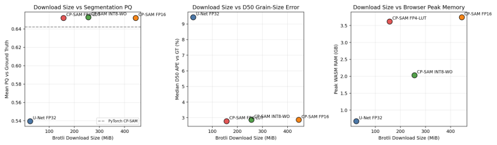
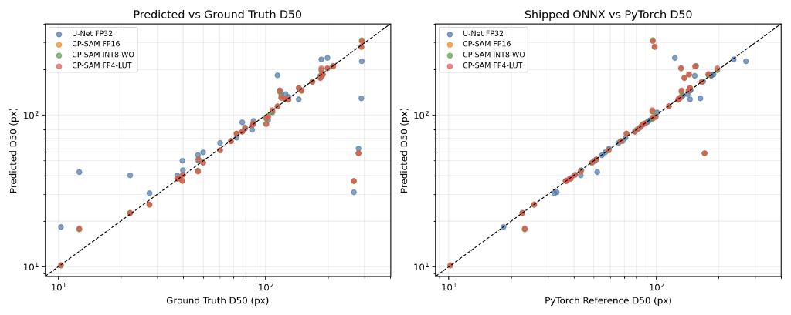
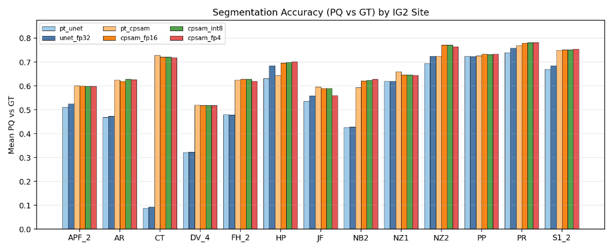

# ImageGrains 2.0 ONNX Quantization Benchmark (`validation/quantization/`)

This directory contains the Colab quantization & evaluation suite for ImageGrains 2.0 (`IG2_full_set_cp_SAM` Cellpose-SAM ViT-L and `IG2_full_set.200525` U-Net) targeting **`onnxruntime-web@1.31.1`**:
- [`imagegrains_final_4model_benchmark_colab.ipynb`](imagegrains_final_4model_benchmark_colab.ipynb): Headline benchmark of all **4 shipped Hugging Face models** ([`inYourOwnBrowser/imagegrains-2.0-onnx`](https://huggingface.co/inYourOwnBrowser/imagegrains-2.0-onnx/tree/main) @ `e79f7b348f6fdc0725b41270a3e22f5777984f26`) vs upstream PyTorch (`cellpose` 3.1.1.1 & 4.1.x) & Ground Truth (`IG2_data.zip`, 40 `official_split == 'test'` images).
- [`imagegrains_quantize_colab.ipynb`](imagegrains_quantize_colab.ipynb): Initial quantization sweep (`fp32`, `fp16`, `fp8_e4m3`, `fp4_e2m1`, `fp4_e2m1_lut`, `int8_wo`, `int4_mnb`).
- [`imagegrains_quantize_mixed_w4_w8_colab.ipynb`](imagegrains_quantize_mixed_w4_w8_colab.ipynb): Follow-up benchmark (`int8_wo_fp32scale`, `int4_mnb_bs64_mixed`, `fp4_lut_mixed_*`).

> **Status:** Complete on branch `validation/quantization-fp8-fp4` (`final_4model_results.json`, `final_4model_per_image.csv`, `results.json`, `results_mixed_w4_w8.json`).

---

## Final 4-Model Headline Benchmark (Hugging Face ONNX vs PyTorch vs Ground Truth)

Recorded in [`final_4model_results.json`](final_4model_results.json) and [`final_4model_per_image.csv`](final_4model_per_image.csv).  
Shipped TypeScript pipeline (`runUnetCellposeInference` / `runCpsamCellposeInference` + `flowsToMasksBrowser` with `maxGrainAreaFraction = 0.40`): `unet_fp32`, `cpsam_fp16`, and `cpsam_fp4` ran through the WASM-verified ORT CPU bridge (`max |WASM - PyCPU| <= 0.00781`); `cpsam_int8` triggered the `0.05` `strict_auto` bridge threshold (`max = 0.4258`, `mean = 0.0068`) and ran all 40 images natively in **`ort_web_wasm`**.

| Model / Ref | Raw (Brotli) MiB | Load (s) | WASM Med (Mean) ms/tile | Peak WASM RAM | All-Zero `cellprob` | PQ vs GT | F1@0.5 vs GT | D50 Med (Mean) APE vs GT | D50 Med Bias vs GT | PQ vs PT | D50 Med APE vs PT | PQ vs FP16 |
| --- | --- | ---: | ---: | ---: | ---: | ---: | ---: | ---: | ---: | ---: | ---: | ---: |
| `pt_unet` | PyTorch (`cp3`) | — | — | — | — | `0.5282` | `0.6162` | `9.26%` (`27.47%`) | `+2.18%` | `1.0000` | `0.00%` | — |
| **`unet_fp32`** | `25.26` (`23.42`) | `0.91` | `757` (`817`) | `696 MB` | `-7.88` | `0.5397` | `0.6348` | `9.44%` (`24.38%`) | `+3.78%` | `0.9298` | `0.45%` | — |
| `pt_cpsam` | PyTorch (`cp4`) | — | — | — | — | `0.6424` | `0.7575` | `4.42%` (`14.52%`) | `-1.16%` | `1.0000` | `0.00%` | — |
| **`cpsam_fp16`** | `588.76` (`444.29`) | `4.55` | `32,402` (`28,565`) | `3,837 MB` | `-5.19` | `0.6521` | `0.7655` | `2.87%` (`8.91%`) | `-0.02%` | `0.9327` | `0.80%` | `1.0000` |
| **`cpsam_int8`** | `301.62` (`255.55`) | `3.12` | `14,544` (`14,552`) | **`2,081 MB`** | `-5.19` | **`0.6529`** | **`0.7667`** | `2.88%` (`8.91%`) | `-0.02%` | **`0.9334`** | **`0.72%`** | **`0.9940`** |
| **`cpsam_fp4`** | **`174.80` (`156.63`)** | `9.12` | **`14,253`** (`14,249`) | `3,708 MB` | `-5.09` | `0.6520` | `0.7660` | **`2.79%`** (`8.97%`) | `+0.20%` | `0.9218` | `1.00%` | `0.9664` |

### Key Conclusions & Model Selection Guide

1. **Zero degradation across all 3 CP-SAM formats (10,000-draw paired bootstrap):**
   - `cpsam_int8` vs `cpsam_fp16` (`mean dAPE = +0.00 pp`, 95% CI `[-0.04, +0.05]`), `cpsam_fp4` vs `cpsam_fp16` (`+0.06 pp`, `[-0.18, +0.31]`), and `cpsam_int8` vs `cpsam_fp4` (`-0.05 pp`, `[-0.31, +0.19]`) are **statistically indistinguishable** on `D50` accuracy and `PQ vs GT` (`0.6520–0.6529`), with `0/40` catastrophic failures (`PQ < 0.20`).
   - All three TS CP-SAM models beat `pt_cpsam` on paired `D50` APE vs GT (`-5.56` to `-5.61 pp`, 95% CI strictly `< 0`) because webGrainy's shipped `flowThreshold = 0.45` (+ `0.40` boulder guard) retains large cobbles on coarse images (`NZ2`, `NB2`) that `cellpose`'s `0.40` threshold dropped.
   - All four ONNX models in ORT-Web WASM match PyTorch FP32 `all_zero` sign `100.0%` (`-5.09` to `-7.88`), whereas PyTorch FP16 & ORT CUDA drifted positive (`+0.652`, `6.49%` sign agreement).
2. **Choosing the right model for browser users:**
   - **`cpsam_int8` (`ig2_cpsam_int8_wo_fp32scale.onnx`) — Recommended CP-SAM default (WASM / standard laptops):** Best accuracy/memory balance. Cuts download by `42%` (`255.6 MiB` brotli), **nearly halves Peak WASM RAM (`2,081 MB` vs `3,837 MB`)**, runs **`2.2×` faster in WASM (`14.5s/tile`)**, and matches FP16 masks at `0.9940` PQ.
   - **`cpsam_fp4` (`ig2_cpsam_fp4_e2m1_lut.onnx`) — Minimum CP-SAM download (`156.6 MiB` brotli):** Same accuracy (`2.79%` med `D50` APE, `0.9664` PQ vs FP16) and fast WASM tiles (`14.3s/tile`), best for slow connections on `>= 8 GB` RAM machines (LUT unpacking still expands Peak WASM RAM to `3,708 MB` and load takes `9.12s`).
   - **`cpsam_fp16` (`ig2_cpsam_fp16.onnx`) — WebGPU `shader-f16` reference:** Largest (`444.3 MiB` brotli, `3,837 MB` WASM RAM, `32.4s/tile` WASM), best reserved for WebGPU `shader-f16` adapters on fast connections.
   - **`unet_fp32` (`ig2_unet_fp32.onnx`) — Fast / mobile / low-RAM model:** `23.4 MiB` brotli, `0.91s` load, `696 MB` RAM, **`~43×` faster per tile than FP16 in WASM** (`757 ms`), `0.5397` PQ vs GT (`9.44%` med `D50` APE); struggles mainly on fine/low-contrast sites (`CT` `0.095` PQ, `NB2` `0.429` PQ) where CP-SAM achieves `0.72` and `0.62`.

---

## Verified `onnxruntime-web@1.31.1` (WASM EP) Compatibility

Tested both on synthetic graphs and full exported ImageGrains 2.0 models against **`onnxruntime-web@1.31.1`** (Node 24, WASM EP):

| Variant | Representation | Loads & Runs in ORT-Web 1.31.1 (WASM)? | Notes |
| --- | --- | --- | --- |
| `fp32` | Reference float32 | **Yes** | CPU reference only (CP-SAM app pipeline passes `float16` input) |
| `fp16` | Native float16 (`ig2_cpsam_fp16.onnx`) | **Yes** | Current shipped baseline (588.76 MiB / 617.4 MB) |
| `fp8_e4m3` | `FLOAT8E4M3FN` weights + `DequantizeLinear(19)` -> `fp16` (symmetric, no zero-point) | **Yes** | Quantizes 96 layers (98.16% of weights); omitting `zero_point` is required |
| `fp4_e2m1` | Native ONNX opset 23 `FLOAT4E2M1` + `DequantizeLinear(23)` / `Cast(23)` | **No (Fails)** | `Failed to find kernel for DequantizeLinear(23)` — `tensor(float4e2m1)` is unsupported |
| `fp4_e2m1_lut` | Storage-only 4-bit FP4: packed `uint8` (2×4-bit) + `Cast(uint8->int32)` + `Gather([256,2] fp16 LUT)` + block-scale `Mul` | **Yes** | Quantizes 96 layers (98.16% of weights) without opset-23 FP4 kernels |
| `int8_wo` | `DequantizeLinear(INT8 -> FLOAT16)` with `fp16` scale | **No (Fails)** | ORT-Web rejects `float16` scale on `INT8` `DequantizeLinear` (`float32` scale + `Cast` required) |
| `int4_mnb_bs32` | `MatMulNBits` 4-bit symmetric (`block_size=32`, activations `fp16`) | **Yes** | Only matched 48 `MatMul` layers (40.90% of weights) |
| `int4_mnb_bs128` | `MatMulNBits` 4-bit symmetric (`block_size=128`, activations `fp16`) | **Yes** | Only matched 48 `MatMul` layers (40.90% of weights) |

In all quantized CP-SAM variants, `Conv` layers (`patch_embed`, `neck`, `out` head), `LayerNorm`, and biases remain in `fp16`.

---

## Summary Table — Cellpose-SAM (`IG2_full_set_cp_SAM`, 40 Held-Out Images)

| Variant | Size (MiB, gz / br) | SHA-256 (prefix) | ORT-Web Load | All-zero `cellprob` mean | PQ vs GT | D50 Mean / Med APE | Mask PQ vs FP16 | Speed (WASM / PyCPU / CUDA ms/tile) | Pass? |
| --- | --- | --- | --- | --- | --- | --- | --- | --- | --- |
| `fp32` | 1175.54 (547.0 / 478.8) | `2e27d7d1` | Yes (5.60s) | `-5.19` | — | — | — | 13,395 / 2,091 / 93.8 | **PASS** (ref) |
| `fp16` | 588.76 (449.4 / 444.3) | `ffee5e66` | Yes (4.54s) | `-5.19` | `0.6521` | `8.91%` / `2.87%` | `1.0000` | 13,917 / 2,273 / 50.0 | **PASS** (base) |
| **`fp8_e4m3`** | **301.19 (244.4 / 241.9)** | `0f37439d` | **Yes (2.54s)** | **`-5.17`** | **`0.6530`** | **`8.95%` / `2.83%`** | **`0.9893`** | 17,887 / 4,850 / 57.3 | **PASS** |
| `fp4_e2m1` | 157.19 (133.9 / 132.3) | `2a196605` | **No** | — | — | — | — | — | **FAIL** |
| **`fp4_e2m1_lut`** | **174.80 (157.7 / 156.6)** | `d49d8f07` | **Yes (9.47s)** | **`-5.09`** | **`0.6520`** | **`8.97%` / `2.79%`** | **`0.9664`** | **14,178** / 2,426 / 55.2 | **PASS** |
| `int8_wo` | 301.19 (257.6 / 255.4) | `3410ab46` | **No** | — | — | — | — | — | **FAIL** |
| `int4_mnb_bs32` | 416.19 (324.8 / 321.3) | `8c79db8f` | Yes (3.45s) | `-5.14` | `0.6504` | `10.18%` / `3.17%` | `0.9780` | 14,193 / 2,314 / 53.9 | **PASS** (outlier) |
| `int4_mnb_bs128` | 410.56 (317.1 / 313.4) | `4515f10a` | Yes (3.49s) | `-5.17` | `0.6508` | `10.13%` / `3.09%` | `0.9714` | 14,202 / 2,313 / 54.1 | **PASS** (outlier) |

### Key Findings & Per-Image Stability
1. **`fp8_e4m3` is virtually lossless and cuts download size nearly in half:**
   - **301.19 MiB** raw (**241.86 MiB** brotli, **45.6% smaller** than `fp16`'s 444.28 MiB brotli).
   - Loads faster (`2.54s` vs `4.54s`) and uses **1 GB less peak RAM** (`2808 MB` vs `3868 MB`) in WASM.
   - `PQ vs GT` (`0.6530`) and `D50` median APE (`2.83%`) match or slightly beat `fp16`, with `0.9893` mean mask PQ vs `fp16` and **zero** bad images (worst per-image mask PQ vs `fp16` is `0.9471`; worst D50 APE delta is `+1.55%`).
2. **`fp4_e2m1_lut` cuts download size by 65% with no accuracy loss and no WASM slowdown:**
   - **174.80 MiB** raw (**156.63 MiB** brotli, **64.7% smaller** than `fp16`).
   - Runs at virtually the **same WASM speed** as `fp16` (`14.18s/tile` vs `13.92s/tile`) and uses less RAM (`3474 MB` vs `3868 MB`).
   - `PQ vs GT` (`0.6520`), `D50` mean/median APE (`8.97%` / `2.79%`), and `mask PQ vs fp16` (`0.9664`) all pass cleanly with **zero** catastrophic failures (worst per-image mask PQ vs `fp16` is `0.9138`; worst D50 APE delta is `+2.47%`).
   - Trade-off: slower WASM session initialization (`9.47s` vs `4.54s`) due to LUT unpacking at load time.
3. **`int4_mnb_bs32` / `int4_mnb_bs128` underperform both `fp8_e4m3` and `fp4_e2m1_lut`:**
   - `MatMulNBitsQuantizer` only matched `48` `MatMul` ops (`40.9%` of weights), leaving size at **410–416 MiB** (`313–321 MiB` brotli) with **no WASM speedup** (`14.2s/tile`).
   - Worse, both had a **+44.3% D50 APE spike** on `NB2__test__P5240929_Crop_3`, pushing mean D50 APE from `8.91%` to `10.18%`.
4. **All passing CP-SAM variants preserve negative `cellprob` on the all-zero tile** (`-5.09` to `-5.19`, `100%` negative).

### Recommendation
- **Best near-lossless drop-in (`W8A16`):**
  - **`int8_wo_fp32scale`**: `301.62 MiB` raw (`255.55 MiB` brotli), `0.9940` mask PQ vs `fp16`, `8.91%` mean D50 APE (identical to `fp16`), `3.12s` load, **2,007 MB peak RAM** (half of `fp16`'s 3,971 MB), and `14.68s/tile` WASM.
  - **`fp8_e4m3`**: `301.19 MiB` raw (`241.86 MiB` brotli, 13.7 MiB smaller than `int8_wo_fp32scale`), `0.9893` mask PQ vs `fp16`, `2.54s` load, `2,808 MB` peak RAM, `17.89s/tile` WASM.
- **Best maximum-compression option:** `fp4_e2m1_lut` (`174.80 MiB` raw / `156.63 MiB` brotli, `0.9664` mask PQ vs `fp16`, `8.97%` mean D50 APE, same WASM speed as `fp16`, zero outliers).

---

## Follow-Up Benchmark (`imagegrains_quantize_mixed_w4_w8_colab.ipynb`)

Results recorded in [`results_mixed_w4_w8.json`](results_mixed_w4_w8.json) and [`results_mixed_w4_w8_per_image.csv`](results_mixed_w4_w8_per_image.csv):

| Variant | Size (MiB, gz / br) | SHA-256 (prefix) | ORT-Web Load | Peak RSS | PQ vs GT | D50 Mean / Med APE | Mask PQ vs FP16 | WASM ms/tile | Notes |
| --- | --- | --- | --- | --- | --- | --- | --- | --- | --- |
| **`int8_wo_fp32scale`** | **301.62 (257.7 / 255.6)** | `2cda0be5` | **Yes (3.12s)** | **2,007 MB** | **`0.6529`** | **`8.91%` / `2.88%`** | **`0.9940`** | **14,676** | Worst mask PQ `0.9652`, worst D50 APE delta `+0.39%` |
| `int4_mnb_bs64_mixed` | 165.61 (140.1 / 138.5) | `ed70b24b` | Yes (2.11s) | 1,532 MB | `0.6486` | `10.16%` / `3.20%` | `0.9665` | 15,038 | Still has `+46.15%` D50 APE spike on `NB2__test__P5240929_Crop_3` |
| `fp4_lut_mixed_fp8` | 174.80 (157.7 / 156.6) | `daad9e65` | Yes (9.38s) | 3,891 MB | `0.6520` | `8.97%` / `2.79%` | `0.9664` | 14,362 | Identical numerics to `fp4_e2m1_lut` (TorchScript `onnx::MatMul_*` names bypassed pattern match) |
| `fp4_lut_mixed_fp16` | 174.80 (157.7 / 156.6) | `d49d8f07` | Yes (9.23s) | 3,672 MB | `0.6520` | `8.97%` / `2.79%` | `0.9664` | 14,422 | Identical to `fp4_e2m1_lut` |

---

## Summary — U-Net (`IG2_full_set.200525`)

U-Net is already small (**25.26 MiB** raw / **23.42 MiB** brotli) and fast (**755 ms/tile** WASM):
- `fp32` (`5e692c55`): **PASS** (`755 ms/tile` WASM, `138 ms/tile` PyCPU, `5.0 ms/tile` CUDA).
- `fp16` (`768fd1ab`, `12.69 MiB`): loads & runs (`761 ms/tile` WASM), `cellprob` mean `-7.88` on all-zero tile; `runUnetCellposeInference` passes `float32` input so `fp16` was not run through the 40-image TS runner.
- `fp8_e4m3`, `fp4_e2m1`, `fp4_e2m1_lut`, `int8_wo`: failed to load in ORT-Web due to `onnx.version_converter` upgrading `ReduceMean` to opset 18+ (`Unrecognized attribute: axes for operator ReduceMean`).
- `int4_mnb_bs32` / `int4_mnb_bs128`: `0` layers quantized (U-Net is `Conv` + `Gemm`, no `MatMul`).

---

## Pass Criteria

A variant passes only if **all four** hold:
1. Loads and runs in `onnxruntime-web@1.31.1` (WASM EP).
2. Zero non-finite outputs across all 23 test tiles, and the all-zero `256×256` tile `cellprob` stays negative (matches PyTorch `fp32` sign ≥ 99%).
3. On the 40-image `IG2_data.zip` (`official_split == 'test'`) held-out set: mean `PQ vs GT` within `0.01` of `fp16` and median `D50` APE within `1.0` percentage point of `fp16`.
4. Mean `mask PQ vs fp16 >= 0.95` on the 40 real images.

---

## How to Reproduce

1. Open [`imagegrains_quantize_colab.ipynb`](imagegrains_quantize_colab.ipynb) in Google Colab (**L4** or **A100** runtime with **High-RAM**).
2. Optionally adjust the `CONFIG` cell (`MODELS_TO_RUN`, `VARIANTS_TO_RUN`, `EVAL_MAX_IMAGES = 40`, `WASM_NUM_THREADS = 4`, `SEED = 42`).
3. Run all cells top to bottom. Outputs (`results.json`, `results_per_image.csv`) are saved to `/content/quant_work/outputs/` and `/content/drive/MyDrive/imagegrains_onnx_quant/`.
